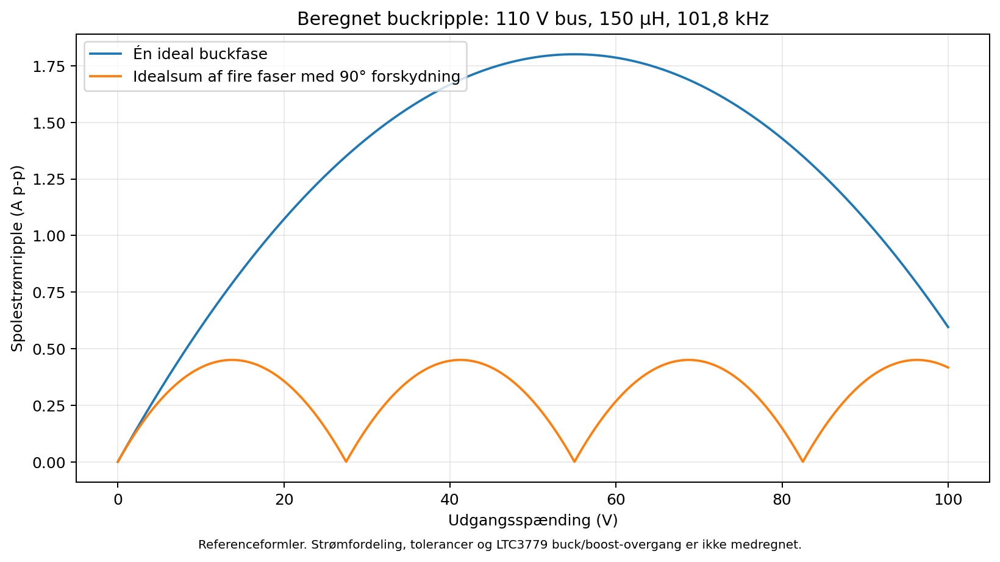

# Arkitektur og dimensionering — 100 V / 40 A laboratorieforsyning

Dette dokument er en beregnet projektforundersøgelse. Det er ikke en verificeret konstruktion eller frigivelse til fremstilling. 100 V × 40 A er **4.000 W kontinuerlig udgangseffekt**. Brugeren har fastlagt 230 V AC på en dedikeret 32 A gruppe, galvanisk isoleret/flydende udgang, 0–100 V og justerbar 0–40 A strømbegrænsning. En fuld KiCad-konstruktion kræver verificerede komponentdatablade og en realiseret regulerings- og beskyttelsesarkitektur.

## Arbejdsgrundlag

Referenceberegningen nedenfor bruger 120 V bus og fire synkrone faser med 10 A middelstrøm per fase og 90° forskydning. Det dokumenterede AC/DC-arbejdsvalg er nu **2 × RSP-3000-48 ved 55 V hver, altså 110 V nominel bus**; se `frontend-selection.md`. 120 V er stadig et beregningspunkt, ikke modulernes garanterede fejlgrænse. Firefasestyringen er et mål, som endnu ikke er tegnet eller afprøvet. Justerbar CV og CC skal bruge en kontrolleret reguleringskommando; den begrænsning, der først nås, skal bestemme driften. Strømgrænsen skal måles og håndhæves i hardware også ved firmwarefejl. Det fastlagte udgangskrav er 0–100 V og justerbar strømgrænse op til 40 A. Præcision og hurtig beskyttelse ved lave strømme indgår særskilt for små opamp-print.

Netdelen bruger købte isolerede moduler. Terminaler, trim, serieforbindelse og separat enable fremgår af det native chassisdiagram `design/frontend/frontend.kicad_sch` og `bom/frontend.csv`. Dets sikringer, afbryder, reverse-dioder og relækontakter er funktionskrav med manglende endelige varenumre, og systemet er ikke kvalificeret. OUT−/AGND må ikke forbindes permanent til chassisjord, hvis udgangen skal være flydende; kapsling og FG jordes stadig. Modulernes samlede øvre OVP-threshold kan være 134,4 V og er ikke et transientloft, så separat busbeskyttelse er nødvendig før integration med effektfasen.

## Input og effektbudget

Den følgende tabel beholder den oprindelige idealiserede reference med 95 % virkningsgrad i begge trin og PF = 0,98. **Det aktuelle modulvalg har andre typiske data:** med 91,5 % AC/DC, antaget 95 % DC-regulator og PF = 0,95 bliver budgettet cirka 4.602 W AC, 21,06 A og 602 W samlet varme. De typiske data er ikke målt ved modulernes faktiske belastning. Brug det nye budget til kabinetarbejdet og tabellen nedenfor til at forstå den tidligere beregning.

| Størrelse | Beregning | Resultat |
|---|---|---:|
| Udgangseffekt | 100 V × 40 A | 4.000 W |
| Effekt fra AC/DC-front-end til buck | 4.000 W / 0,95 | 4.211 W |
| Samlet AC-indgangseffekt | 4.000 W / 0,9025 | 4.432 W |
| AC-indgangsstrøm, 230 V, PF = 0,98 | 4.432 W / (230 V × 0,98) | 19,7 A |
| 120 V DC-busstrøm ved fuld last | 4.211 W / 120 V | 35,1 A |
| Tab i buck-trin | 4.211 W − 4.000 W | 211 W |
| Tab i AC/DC-front-end | 4.432 W − 4.211 W | 222 W |
| Samlet varme | 4.432 W − 4.000 W | 432 W |

En 32 A gruppe giver nominelt 7.360 VA ved 230 V, så den beregnede 19,7 A middelindgangsstrøm har margin til gruppens nominelle strøm. Dimensionering af stik, kabler, afbrydere, inrush og netfilter skal stadig baseres på de konkrete komponenter og installationsforhold. En front-end specificeret til mindst cirka 4,5 kW DC-udgang ved den relevante omgivelsestemperatur vil give en begrænset margin over de beregnede 4,211 kW; modulernes temperaturderating og kortvarige lastændringer skal kontrolleres. Busmin/max skal tages fra det valgte produkt, før komponent-rating og maksimal duty kan fastlægges.

Et almindeligt 230 V / 16 A kredsløb har højst 3.680 VA før tab og kan derfor ikke levere 4 kW kontinuerlig udgangseffekt. Tabellen tager ikke højde for startstrøm, spændingsfald, ledningsdimensionering eller front-end-derating. Ved lav netspænding stiger indgangsstrømmen for samme effekt; det endelige indgangsområde skal følge front-endens datablad.

## Foreløbig buck-dimensionering

Beregningspunktet er 120 V ind, fire faser, 100 kHz per fase, 150 µH per fase og 10 A middelstrøm per fase. Der er ikke valgt en konkret spole endnu.

For en ideal buck er D = Vout / Vin, og strøm-rippel per fase er:

`ΔIL = Vin × D × (1 − D) / (L × fs)`

| Udgangsspænding | Duty | Rippel per fase (p-p) | Fasestrømmens maksimale værdi ved 10 A middel |
|---:|---:|---:|---:|
| 100 V | 0,8333 | 1,11 A | 10,56 A |
| 60 V | 0,5 | 2,00 A | 11,00 A |
| 30 V | 0,25 | 1,50 A | 10,75 A |

Den ideelle sumrippel for N identiske, præcist forskudte faser kan beregnes med `a = N×D − floor(N×D)`:

`ΔItotal = Vin × a × (1 − a) / (N × L × fs)`

For fire faser er værste idealiserede sumrippel 0,50 A p-p. Ved 100 V er den 0,444 A p-p. Tolerancer i spoler, faseforskydning, modstande og strømfordeling øger den faktiske rippel; dette er ikke et løfte om terminalrippel.

`scripts/design_calcs.py` genberegner det aktuelle 110 V-effektbudget og en særskilt ideal buckripple-kurve ved 101,8 kHz. Resultaterne findes i `exports/analysis/design_budget.json` og `ideal_buck_ripple.png/.pdf`. Grafen antager identiske faser med ideel 90° forskydning; den dokumenterer ikke, at fire LTC3779-kort har strømfordeling eller den viste ripple. Ved 100 V / 110 V ligger duty 90,91 % tæt på controllerens 91,67 % buck-only-grænse, så reel drift kan skifte til buck/boost ved busfald og tolerancer.

Spolen skal specificeres ved den maksimale temperatur og fasefejlstrøm. Det aktuelle enkeltfasekrav er 150 µH, Irms ≥15 A og mætningsstrøm ≥25 A **ved varm spole**, fordi dens native sensegrænse med tolerance/ripple kan tillade cirka 20,5 A peak. Det ældre 15 A-mætningspunkt er utilstrækkeligt til denne fase. Energi per spole ved normalberegningspunktet 11 A er `½ × 150 µH × (11 A)² = 9,08 mJ`, men fejlpunkterne skal også vurderes. Kernetype, vikling, DC-modstand, kernetab og temperaturstigning kræver producentdata. Induktansen er et designpunkt, ikke et indkøbt varenummer.

MOSFET-valget skal inkludere 110 V nominel bus, modulernes mulige samlede 134,4 V OVP-threshold og særskilt analyserede transienter, SOA, gate-ladning, reverse recovery, pakketemperatur og kortslutningsfejl. Effektfasens 120 V-proceduregrænse kræver selvstændig busbeskyttelse; den er ikke front-endens garanterede maksimum. En 200 V MOSFET er et kandidatspændingsniveau; det er ikke tilstrækkeligt alene at kontrollere DC-spændingen. Controllerens 150 V-grænser skal også overholdes, uanset MOSFET-rating.

## Udgangskondensator og dynamik

Det oprindelige hypotetiske systemberegningspunkt på 4 × 470 µF = 1.880 µF, mindst 160 V mærkespænding, beholdes her som energieksempel; det findes ikke i den aktuelle BOM. Den nuværende enkeltfase har 2 × 47 µF/200 V og 2 × 1 µF/250 V ved udgangen, nominelt 96 µF. Fire sådanne faser ville have 384 µF, men flerfasekortet er ikke implementeret. Der er endnu ikke valgt serie, ESR, rippelstrømskapacitet eller levetid. Ved 100 V lagrer det ældre 1.880 µF-eksempel `½ C V² = 9,4 J`, mens 96 µF lagrer 0,48 J og 384 µF lagrer 1,92 J. Udgangsterminalerne kræver en kontrolleret udladningsvej og en faktisk spændingsmåling efter afbrydelse.

Den ideale kapacitive ripple ved 0,5 A p-p og 400 kHz sumrippel er omkring 0,083 mV efter trekantsapproksimationen `ΔV = ΔI / (8 f C)`. ESR, ESL, printinduktans og målemetode vil dominere; dette tal kan ikke bruges som færdig rippelspecifikation.

Et lastspring fra 0 A til 40 A i 100 µs giver `ΔV = I Δt / C ≈ 2,13 V`, hvis kondensatoren alene leverer ændringen. Kapacitansen kan derfor ikke vælges udelukkende fra steady-state-rippel. Kompensation og regulatorbåndbredde skal verificeres med netværksanalyse og lastspring i både CV og CC.

## Strømmåling

En separat samlet 1 mΩ Kelvin-shunt ved 40 A giver 40 mV og 1,6 W. Projektets eksterne krav er mindst 10 W og 50 A DC, med fire terminaler; præcision, temperaturkoefficient og køling skal vælges og verificeres. Kelvin-forbindelser må ikke dele kobber med effektstrømmen.

INA240-familien er en kandidat til lavside-strømmåling. En INA240A2 har nominelt 50 V/V gain, hvilket ville give 2,00 V ved 40 mV, og dens negative common-mode-evne gør lavside-placering relevant. Det nominelle common-mode-område må ikke bruges som argument for højside-placering på en 100 V udgang: INA240 er ikke en 100 V common-mode-sensor. De præcise grænser og ben skal verificeres i databladet før komponenten bruges. Lavside-shunten hæver udgangsminus med op til 40 mV i forhold til effektjord; remote sense og regulatorens reference skal tage højde for dette.

Til hver buck-fase er eksempelvis 5 mΩ en foreløbig sensormodstand: 50 mV ved 10 A og 0,5 W. Dens værdi må **ikke** vælges endeligt før controllerens strøm-sense-grænse, fejlgrænse og rippeldefinition er verificeret. Fire shunter kan ikke erstatte en totalstrømmåling, hvis deres fejl eller styring tillader forkert strømfordeling.

## Strømbegrænsning til små opamp-print

Justerbar 0–40 A CC er en kendt del af brugerens mål. En strømgrænse til et lille opamp-print kan ligge mange størrelsesordener under 40 A, og derfor kan én 1 mΩ shunt ikke uden videre give tilstrækkelig præcision i hele området. Den giver kun 1 µV ved 1 mA og 10 µV ved 10 mA. Sensoroffset, termospændinger, drift og støj skal sammenlignes med disse signaler. Der kræves en dokumenteret lavstrøms-målestrategi, eksempelvis omskiftelige shunt-/forstærkningsområder eller et særskilt præcisions-eftertrin. Områdeomskiftning må ikke skabe et tidsrum uden strømbegrænsning.

Desuden begrænser en buck-regulators CC-sløjfe den tilførte energi, men ikke nødvendigvis den energi, som allerede findes i udgangskondensatorerne. Beregningspunktet 1.880 µF lagrer 23,5 mJ ved 5 V og 9,4 J ved 100 V. En pludselig fejl på et lille print kan få strøm fra kondensatoren, før buckens strømgrænse reagerer. Hurtig beskyttelse af små print kræver derfor en kontrolleret udgangsafbryder eller strømbegrænser efter bulk-kondensatoren og en verificeret transientgrænse. Kredsløbet skal også håndtere den energimængde, der er nødvendig for stabilitet og udgangsripple. At indstille CC til en lav værdi er ikke i sig selv dokumentation for skadefri forsyning af en fejlramt opamp.

## Regulator og 0 V

Databladet for LTC3895 blev hentet og gennemgået den 9. oktober 2026. Den tidligere kandidat er nu **afvist til direkte 100 V-udgang**: arbejdsområdet er 4–140 V input, men kun 0,8–60 V output, og SENSE+/SENSE− har 65 V absolute maximum. Et højt inputområde gør ikke controlleren egnet til en tilsvarende høj udgang. Der er ikke lavet et LTC3895-effektprint.

LTC3779 er undersøgt i stedet. Det officielle datablad angiver 4,5–150 V input og 1,2–150 V output, fire switch-MOSFET'er, 1,2 V feedback-reference og en gennemsnitlig strømgrænse på nominelt 50 mV over en valgt shunt. Det konkrete delprojekt i `design/power/` undersøger én fase omkring 100 V / 10 A; det er ikke en 40 A konstruktion og har endnu ingen justerbar laboratorie-CC, aktiv 0 V-regulering eller færdigroutet print. Se `docs/power-phase.md` for den aktuelle pinout, værdier og begrænsninger.

Analog Devices DC2456A er en kilde til controllerens referencekobling. Producentens dokumenterede demopunkt er 48 V / 10 A; det dokumenterer ikke vores ændrede udgang omkring 100 V eller en opskalering til 4 kW. Fire parallelle LTC3779-moduler har ikke en verificeret strømfordelingsløsning i denne revision.

En standard feedback-regulator med positiv referencespænding kan ikke uden videre indstilles til en aktivt reguleret 0 V. Et potentiometer i feedback-deleren giver normalt en positiv minimumsspænding. Desuden giver minimum tændtid ved fast frekvens et pulskvantum: hvis minimum tændtid eksempelvis er 50 ns, er den tilsvarende nominelle minimum-duty ved 100 kHz 0,005 og Vin×D = 0,6 V. Dette er et eksempel, ikke en verificeret LTC3895-grænse. Pulse-skipping og anden regulering kan sænke gennemsnittet, men skal analyseres.

Brugerens 0–100 V krav er fastlagt; implementeringen af den nedre ende er en åben konstruktionsopgave. En DC-egnet udgangsafbryder plus udladning kan give en spænding tæt på 0 V, når udgangen er slukket, men det dokumenterer ikke aktiv CV-regulering helt ned til 0 V. Regulering tæt på 0 V kan kræve niveau-forskudt feedback, anden kontrolarkitektur eller et efterreguleringstrin og muligvis en aktiv sink. En source-only buck kan ikke holde en ekstern tilbagefødende belastning på 0 V. Den endelige konstruktion skal derfor specificere og verificere nedre spændingsgrænse, offset, restspænding og energihåndtering i forhold til det ønskede 0–100 V interval.

LM5146 er ikke en erstatning til den foreslåede 120 V-bus: dens familie er til 100 V input, så den har hverken det nødvendige inputområde eller margin til 100 V udgang fra 120 V input. UCC21520 er en kandidat til en separat isoleret gate-driver-arkitektur, men en sådan løsning kræver et andet reguleringsdesign og en verificeret forsyning til den flydende high-side-driver; den løser ikke CV/CC-reguleringen alene.

## Hardwarebeskyttelser og konstruktion

Følgende funktioner skal have konkrete kredsløb og efterprøvning før effekttrinnet kan frigives:

- Hardware-overstrøm per fase med håndhævet maksimal pulseenergi og shutdown ved mættet spole.
- En uafhængig samlet overstrømsgrænse og overvoltage-shutdown, som kan stoppe gates og afbryde DC-forsyningen.
- Hardware-deadtime og interlock mellem high-side og low-side MOSFET; reset, brownout og manglende clock skal føre til gates slukket.
- Temperaturmåling ved effekttransistorer og spoler samt beskyttelse ved blæserfejl.
- Defineret opstart, soft start, inrush, udgangsfrakobling og udladning.
- Håndtering af batteri eller motor på udgangen, omvendt polaritet og tilbageført energi.
- DC-egnede sikringer, afbrydere, stik og terminaler med dokumenteret brydeevne og temperatur-rating.
- Remote-sense-begrænsning og fallback, hvis senseledninger afbrydes.

40 A skal ikke føres i almindelige tynde printspor. Busbars eller dokumenteret tyk kobberkonstruktion med passende tilslutninger er et realistisk udgangspunkt. Den nødvendige sporbredde og kobbertykkelse skal beregnes fra det faktiske stackup, køling og tilladte temperaturstigning. Snubberværdier kan først vælges efter måling af switch-node-ringing; en vilkårlig RC-kombination giver ikke verificeret oversvingsbeskyttelse.

En integreret AC-version skal desuden have defineret beskyttelsesjord, isolation, afstanden mellem net/sekundær, kapsling, sikringer og netfilter. Afstande kan ikke fastsættes fra “100 V” alene: arbejds- og transientspænding, materialer, forureningsgrad, højde og isolationstype indgår. Et eksternt isoleret DC-modul fritager ikke sekundærprintet fra afstanden og kapslingen omkring 100–120 V DC.

## Testpunkter til den endelige konstruktion

| Testpunktgruppe | Formål | Måleprincip |
|---|---|---|
| VIN og PGND | 120 V bus, inrush, fald under last | Spændingsklassificeret differentialmåling; intet ubeskyttet scope-ground på flydende kraftdel |
| VOUT og OUT− | CV, CC, ripple, oversving, udladning | Direkte ved terminaler; ripple med kort målesløjfe og defineret båndbredde |
| Fase 1–4 switch-node | Timing, duty, ringing og faseforskydning | Differentialprobe med tilstrækkelig spænding og common-mode-egenskaber |
| Gate-source for alle 8 transistorer | Gate-amplitude, deadtime, Miller-turn-on | Mål gate i forhold til dens egen source; high-side gate er ikke jordrefereret |
| Kelvin-faseshunt ± | Peakstrøm, strømfordeling, current limit | Differentialmåling; belast ikke sensekredsløbet |
| Samlet shunt ± og sensor-output | Totalstrøm og CC-funktion | Differential Kelvinmåling og lavspændingssignal |
| VFB, ITH/kommando, setpoints | Kontrolsløjfe og CV/CC-overgang | Scope eller netværksanalyse uden at ændre sløjfens impedans |
| Enable, fault, OVP og OTP | Fejllåsning og genstart | Kontroller både signal og fysisk gateslukning |
| Hjælpeforsyninger | Driver, analog- og logicforsyning | DC og opstartsripple, før effektbus tilsluttes |
| Termistorer/fan-tacho | Køling og termisk shutdown | Sammenhold elektrisk måling med uafhængig temperaturmåling |

Disse er funktionskrav. Referencerne TP1 osv. skal genereres fra og stemme med det faktiske KiCad-skema, PCB og den endelige stykliste.

## Selvstændigt passivt måleprint

Et passivt måle- og testprint kan konkretiseres før effekttrinnet, fordi det ikke indeholder uverificerede controllerben eller kommuterer 4 kW. Det er et delprojekt og kan ikke alene fungere som laboratorieforsyning.

Et spændingsmålepunkt kan bruge tre seriekoblede 130 kΩ / 0,1 % modstande over en 10 kΩ / 0,1 % bundmodstand. Samlet modstand er 400 kΩ, delingsforholdet 40:1 og Thevenin-modstanden 9,75 kΩ. 100 V giver 2,500 V; 120 V giver 3,000 V. Ved 120 V løber 0,300 mA, hver 130 kΩ-modstand taber 39 V og dissipaterer 11,7 mW, mens 10 kΩ-modstanden dissipaterer 0,9 mW. Faktisk modstandsserie skal have dokumenteret spændingsrating og tolerance; 1206-størrelsen alene er ikke en specifikation.

To ens delere kan måle henholdsvis OUT+ og OUT− i forhold til AGND. Udgangsspændingen findes som `40 × (Vplus_adc − Vminus_adc)`. AGND defineres som den eksterne DC-forsynings retur, på den lave side af den eksterne 1 mΩ shunt. Ved 40 A er OUT− omkring +40 mV i forhold til AGND; minus-delerens output bliver derfor kun 1 mV. Dette kræver tilstrækkelig opløsning, korrekt offsethåndtering og kalibrering af den senere ADC.

Selv 0,1 % modstande giver omtrent ±0,195 % worst-case spændingsratiofejl, hvis top- og bundmodstandstolerancer falder i modsatte retninger. Ved 100 V er det cirka ±195 mV før kalibrering. Dette print kan derfor ikke uden videre kaldes et præcisionsvoltmetre. Temperaturdrift, PCB-lækage og ADC-inputstrøm indgår også. ADC'en skal acceptere dividerens 9,75 kΩ kildeimpedans eller have tilstrækkelig acquisition-tid/buffer; en kondensator alene dokumenterer ikke ADC-kompatibilitet.

En ekstern fireterminal 1 mΩ / mindst 10 W shunt, specificeret til mindst 50 A DC og korrekt køling, kan føres til en differential ADC/PGA via Kelvin-ledninger. Ved 40 A er shuntspændingen 40 mV og effekten 1,6 W. Et filter med 1 kΩ i **hver** Kelvin-signalvej og 10 nF direkte mellem de filtrerede signaler har cirka `1 / (2π × 2 kΩ × 10 nF) = 7,96 kHz` differential grænsefrekvens. Det filtrerer ikke common-mode-støj på samme måde. Det er ikke den hurtige hardware-overstrømsmåling, som effekttrinnet kræver.

AGND er en del af den flydende sekundærside. Måleprintet indeholder ikke selv en galvanisk isolationsbarriere. En jordet ekstern ADC, et USB-kabel, en PC eller oscilloskopets almindelige ground-klemme kan forbinde AGND til beskyttelsesjord og dermed ophæve den flydende udgang. Den senere ADC/controller skal derfor ligge på samme flydende side med egnede isolerede kommunikations- og hjælpeforsyningsforbindelser, hvis systemet skal bevare brugerens isolerede/flydende udgangskrav.

Det endelige ADC/PGA-valg skal fastlægge inputområde, inputstrøm, kildeimpedans, reference, offset, rail-off-adfærd og overvoltagebeskyttelse. Hvis batterier eller regenerative belastninger kan føre negativ strøm, kan shuntsignalet blive negativt; en unipolar ADC kan ikke antages at håndtere det. Clamp-kredsløb kan heller ikke vælges uden at kende de beskyttede inputs. Senseledninger fra kraftdelen skal beskyttes tæt på energikilden med dokumenteret DC-egnet løsning, så en beskadiget ledning ikke kan kortslutte effektbussen før dividerens strømbegrænsende modstande.

## Hvad der konkret blokerer et fremstillingsklart effektprint

1. Indgangen er fastlagt til 230 V AC / 32 A og udgangen til isoleret/flydende 0–100 V / 40 A. To RSP-3000-48 er det dokumenterede arbejdsvalg; kvalifikation af serie-/flydende drift, busmin/max under fejl og uafhængig busbeskyttelse mangler.
2. Kravet om 0–100 V er kendt, men aktiv regulering ved 0 V er ikke realiseret. Tilladt ripple, lastspring, lavstrøms-CC-præcision og håndtering af tilbageført strøm skal fastlægges i designet og efterprøves.
3. Controllerens officielle ben, driftsspecifikationer, synkronisering/strømfordeling og anbefalede layout skal verificeres. LTC3779-databladet er nu hentet, men den samlede programmerbare CV/CC-løsning og skalering er endnu ikke verificeret.
4. Spole, MOSFET, driver, DC-afbryder, sikringer, terminaler og certificeret front-end skal vælges med faktisk tilgængelig producentdokumentation.
5. Magnetisk, elektrisk og termisk prototypevalidering, isolationstest og loop-stabilitet kan ikke udføres af en KiCad ERC/DRC-kørsel. Et korrekt åbnende KiCad-projekt er ikke evidens for 4 kW funktion.

Først efter disse punkter kan et komplet skema med faktiske komponentben og et kobberlayout vurderes for fremstilling. Et PCB-koncept med komponentzoner, forbindelser og testpunktplan er nyttig projektfremdrift, men skal mærkes tydeligt som en uafsluttet konstruktion.

## Kilder og verifikationsstatus

- Analog Devices LTC3895, officiel datablad-URL forsøgt: https://www.analog.com/media/en/technical-documentation/data-sheets/3895fa.pdf — hentet og gennemgået 9. oktober 2026; gemt som `references/LTC3895.pdf`; controlleren afvist til direkte 100 V.
- Texas Instruments LM5146, officiel datablad-URL forsøgt: https://www.ti.com/lit/ds/symlink/lm5146.pdf — HTTP 403; databladet er ikke hentet eller gennemgået.
- Installeret KiCad-symbolbibliotek: `/usr/share/kicad/symbols/Amplifier_Current.kicad_sym` indeholder INA240A1D og varianter. `/usr/share/kicad/symbols/Driver_FET.kicad_sym` indeholder UCC21520DW. Bibliotekets symboler er ikke en erstatning for grænseværdier og layoutanvisninger i producentdatablade.
- Analog Devices LTC3779: https://www.analog.com/media/en/technical-documentation/data-sheets/ltc3779.pdf — hentet og gemt som `references/LTC3779.pdf`; outputområde og controllerben gennemgået.
- Alle effekttal, rippeltal og energiangivelser ovenfor er algebraiske beregninger ud fra de eksplicit angivne forudsætninger.
