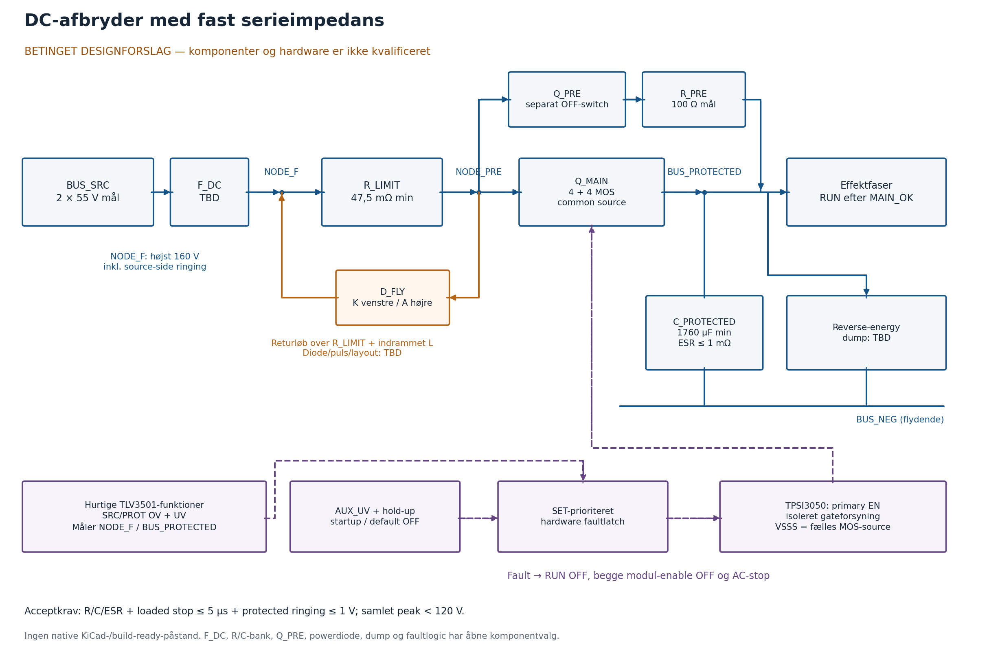
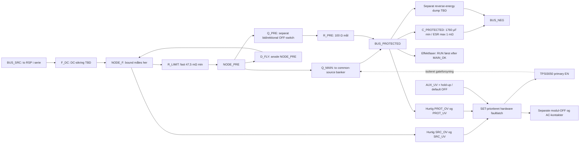

# DC-afbryder med fast serieimpedans — betinget designforslag

Status 10. oktober 2026: **nyt konkret kredsløbsforslag med efterviselig acceptgrænse, ingen fysisk kvalifikation eller fabrikationsfrigivelse.** Forslaget bruger den eksisterende 110 V front-end og en fast serieimpedans, separat beskyttet kapacitet, hurtige spændingsdetektorer og låst DC-afbrydelse. Modellen kan holde sig under 120 V ved de udtrykkelige grænser nedenfor. Disse grænser er konstruktionskrav, som endnu mangler komponent- og måleevidens.

Det er et alternativ til en lineær 40 A pass-clamp. IPP110N20N3 G undersøges **kun som switch**. Den tidligere lineære SOA-afvisning gentages ikke som løsningen. Ingen KiCad-fil, eksisterende BOM eller tidligere hoveddokument er ændret af denne undersøgelse.

## Konkret arbejdspunkt og acceptkrav

| Parameter | Foreslået fuldt kvalificeret grænse | Faktisk status |
|---|---|---|
| R_LIMIT | 50 mΩ mål; **47,5 mΩ minimum** og 52,5 mΩ maksimum gennem temperatur, aldring og faultpulser | Modstand/bank, køling, induktans og pulsdata **TBD** |
| C_PROTECTED | 2.200 µF mål; **1.760 µF effektivt minimum** / 2.640 µF maksimum | Separat bank kræves; ikke den eksisterende fases bulk; komponenter **TBD** |
| Bankens højfrekvente ESR | **Højst 1,0 mΩ** i det relevante faultforløb, inklusive forbindelser | **TBD**; en vilkårlig 2.200 µF elektrolyt opfylder ikke dette ved mærkeværdien alene |
| Sourcebound | **Højst 160 V ved NODE_F**, inklusive source-side ringing | **Ikke fabrikant- eller måleverificeret** |
| Fuld detection→åben effektvej | **Højst 5,0 µs**, med den faktiske switchbank, filtre, forsyninger og temperatur | **Ikke verificeret** |
| Beskyttet terminalringing/ESL-tilskud | **Højst 1,0 V** oven på RC+ESR-resultatet | Clamp, returløb og layout **TBD** |
| Kritisk beskyttet terminalgrænse | Under **120 V**, altså under 119 V i RC+ESR-modellen med 1 V reserve | Den eksisterende fases proceduregrænse |
| Seneste protected-OV-start | Højst **114,880 V**, inklusive tærskelfejl og nødvendigt comparatoroverdrive | Reference, divider og temperaturbudget **TBD** |

R_LIMIT må **aldrig bypasses**, heller ikke efter precharge. ±5 % er hele R-budgettet; en del købt med ±5 % initial tolerance har ingen ekstra plads til negativ TCR/aldersdrift. Tilsvarende er −20 % hele C-budgettet, ikke blot en tilladt indkøbstolerance før temperatur, DC-bias og aldring. C_PROTECTED's effektive mikrosekundrespons, ESR/ESL og pulsstrøm skal kvalificeres som en bank med den faktiske kabling.

De 160 V er et eksplicit integrationskrav, ikke udledt af RSP's OVP. **134,4 V er summen af de to modul-OVP-tærsklers øvre endepunkter; det er ikke en maksimal transientspænding.** Hvis en sourcebound på 160 V ikke kan etableres, må dette arbejdspunkt afvises eller dimensioneres om. Modellen accepterer ikke en ubounded source.

## Blok- og forbindelsesdiagram



PNG- og SVG-figuren genereres uden native CAD-påstand med `python3 scripts/bus_disconnect_envelope.py --diagram`. Markdown-filen indeholder også samme funktionsarkitektur som redigerbar Mermaid-kilde.



De konkrete forbindelser er:

- R_LIMIT ligger mellem NODE_F og NODE_PRE, efter DC-sikringen og før **begge** energiveje. Q_PRE/R_PRE bypasser kun Q_MAIN; de bypasser ikke R_LIMIT.
- Q_MAIN består som arbejdskandidat af fire parallelle N-MOSFETs i hver halvdel. Drain på den ene bank går til NODE_PRE, drain på den anden til BUS_PROTECTED. Alle otte sources mødes i den fælles flydende source-node. Hver MOS får egen gate-R og gate/source-pulldown; værdier og layout mangler.
- TPSI3050 VSSS går til denne **fælles MOS-source**, og VDRV driver gates. VSSS må ikke uden videre bindes til BUS_NEG. Primary VSSP, spændingsmåling og faultlogic refereres til BUS_NEG med Kelvin-forbindelser.
- Q_PRE kræver sin egen switch-/gatefunktion med tovejs spærring i OFF; dens gatesupply må ikke kortslutte Q_MAIN's flydende reference. Precharge-driver og MOSFETs er TBD.
- C_PROTECTED og et eventuelt dump ligger mellem BUS_PROTECTED og BUS_NEG tæt på switch/faseindgangene. Der må ikke være en ubeskyttet direkte forbindelse fra BUS_SRC til effektfasens VIN.
- D_FLY har **anode NODE_PRE og katode NODE_F**. Når Q_MAIN åbner, giver denne kilde-side diode et strømreturløb over R_LIMIT og den indrammede sløjfeinduktans. Den leder ikke strømmen gennem BUS_PROTECTED som normal dumpvej. Den er et komponent-/layoutkrav, ikke en kvalificeret diode.
- Induktans uden for D_FLY-løkken, source-side nodeoversving og diode-forward-recovery kræver deres egen snubber/clamp. Den verificerede 160 V-bound skal gælde på den faktiske NODE_F under dette forløb.
- Begge RSP-moduler slukkes via hver sin isolerede enablefunktion. PE/FG/chassis indgår ikke i den flydende logicground eller stopkontakterne.

En udgang, som regenererer ind i BUS_PROTECTED, har stadig brug for dump/stop. En bidirektional OFF-switch isolerer energien; den fjerner den ikke. Dette input-step-envelope gælder ikke som et reverse-energy-bevis; dump kvalificeres særskilt som beskrevet i `docs/bus-protection.md`.

## Tærskler, latch og default OFF

Et konkret detektorsæt er hurtige TLV3501-funktioner for SRC_OV, SRC_UV, PROT_OV, PROT_UV og AUX_UV. Følgende setpunkter er designkrav, **ikke færdige divider- eller referencenumre**:

| Funktion | Foreslået setpunkt / samlet fejlbudget | Rolle |
|---|---|---|
| SRC_OV og PROT_OV | 114,0 V; samlet tærskelfejl højst ±0,65 V over det kvalificerede temperaturinterval | Hurtig SET-fault; max threshold 114,65 V |
| Comparatoroverdrive for OV | 5 mV på input; højst 0,230 V yderligere busstigning til nødvendigt overdrive | Startbound 114,880 V; min dividergain skal understøtte konverteringen |
| SRC_UV | 103,0 V mål; fejl højst ±0,65 V | Fjerner enable før utilstrækkelig sourceforsyning |
| PROT_UV | 101,0 V mål; fejl højst ±0,65 V | Aktiv i RUN; beskytter mod buskollaps/afbrudt effektvej |
| AUX_UV | Skal udløse mens den holdte logicrail stadig er **mindst 3,1 V** | Holder styringen aktiv til EN er sikkert LOW |

Det tidligere normalbudget er 107,525–112,475 V før ripple; R_LIMIT kan ved 40 A og 52,5 mΩ reducere loaded minimum til cirka 105,425 V før FET/kabeltab. UV-setpunkterne har dermed et begrundet arbejdsområde. Faktisk moduldynamik, ripple, total tab og LTC3779-operation tæt på buck-boost skal verificeres; denne tabel kvalificerer ikke 100 V / 40 A-regulering.

Faultlatch er SET-prioriteret. Enhver hurtig fault skal overstyre RESET og straks deaktivere Q_MAIN, Q_PRE og alle faser. MCU/UI kan kun anmode om start/reset; den kan ikke overstyre en aktiv hardwarefault. EN har fysisk pulldown og en AND-funktion, som kræver AUX_GOOD, SOURCE_WINDOW_GOOD, clear fault og precharge-/gateinterlocks. Manglende logicforsyning giver ingen HIGH-enable. Startup/POR skal sætte fault/disable, så strøm tilbage ikke automatisk genstarter efter et power loss.

PROT_UV forventes aktiv under opladning af en tom bus. Den må kun maskeres i den dokumenterede PRECHARGE-state, hvor Q_MAIN og effektfaser er OFF; SRC_OV, SRC_UV, PROT_OV og AUX_UV er fortsat aktive. Når Q_MAIN er verificeret ON, aktiveres PROT_UV før effektfaserne kan starte. En fault eller timeout i enhver state kræver bevidst reset og ny precharge.

## Fabrikantdata kontra delaykrav

Eksisterende originale kilder er `references/TPSI3050.pdf` (SLVSGO9C), `TLV3501.pdf` (SBOS321E), `TPS3700.pdf` (SBVS187G) og `IPP110N20N3G.pdf` (Rev. 2.3). Proveniens ligger i `references/bus-protection-sources.json` og `references/sources.json`.

| Led | Dokumenteret grænse / faktisk vilkår | Allokeret krav |
|---|---|---:|
| Sensefilter/inputsettling | Divider, reference og filter er ikke valgt | ≤0,500 µs |
| TLV3501 | Side 6: max 12 ns ved 5 mV overdrive / 100 mV inputstep over −40…125 °C; karakteriseret, ikke production-tested. Intet generelt zero-overdrive-/langsomt-rampbevis | 0,012 µs under kvalificerede inputforløb |
| Faultlatch/AND/EN | Logic-MPN og input-/outputloads mangler | ≤0,250 µs |
| TPSI3050 OFF | Side 10: max 3 µs EN→VDRV10 % i 3-wire ved specificeret 100 pF load, CDIV1/2 = 3,3 nF og RPXFR = 7,32 kΩ | 3,000 µs delbudget; faktisk bank skal kvalificeres |
| Yderligere loaded gate/current interruption | Afhænger af Qg, gate-R, hot-MOS og layout | ≤1,000 µs |
| Ekstra margin | Ikke en målt delay | 0,238 µs |
| **Hele kæden** | Max er endnu ikke bevist med de faktiske dele | **≤5,000 µs** |

TPSI3050's 3 A peak sink og 1,7 Ω low-driver-resistance er **typiske**, ikke garanterede minimums-/maksimumsgrænser (side 7). Derfor giver Qg/3 A kun et estimat. Ved primærforsyningstab er 100 µs timeout **typisk uden max** (side 10). Denne timeout indgår ikke i det hurtige faultbudget.

TPS3700 side 7 angiver 18/29 µs som typiske propagationtider uden maksimum. Den kan supervisere langsommere vinduer/startup, men den dokumenterer ikke 5 µs-stopkæden. Dens startup-state er først korrekt efter op til **450 µs** (side 6); enable skal holdes OFF under supervisorstartup. TLV3501's offsetmaksimum på ±6,5 mV er ved 25 °C (side 5), så ±0,65 V samlet systemfejl over temperatur kræver mere data/afgrænsning og faktisk reference-/dividerkvalifikation.

## Efterviselig RC+ESR-model

Kør:

```sh
python3 scripts/bus_disconnect_envelope.py
```

Scriptet gemmer `exports/analysis/bus_disconnect_envelope.json`. Det bruger SI-enheder, no-load som worst-case for stigende protected-bus, fast R og en lumped C+ESR. FET-RDS(on) bidrager ikke til den garanterede R; den ukvalificerede ekstra modstand må ikke bruges til at bestå. ESL/kabelringing ligger i den særskilte 1 V-bound.

Med `Rs = Rmin`, `Re = ESRmax`, `τ = (Rs + Re) × Cmin`, en bounded source-step `Vs` og start `V0` er den **terminale** protected-spænding:

`Vterminal(t) = Vs − (Vs − V0) × Rs/(Rs + Re) × exp(−t/τ)`

Den direkte ESR-step er medtaget. Med nul ESR reduceres udtrykket til den almindelige RC-opladning. Den seneste tilladelige åbning før target `Vt` er:

`tmax = τ × ln[(Vs − V0) × Rs / ((Vs − Vt) × (Rs + Re))]`

Er den øjeblikkelige ESR-step allerede over target, bliver den tilladte tid nul. En ubounded/modstridende source, Rmin, Cmin, ESRmax, start, delaymax eller ekstrapeak giver **model_valid = false / model_accepts = false**. Fysisk kvalifikation kræver desuden verificerede bounds, varmt switch-SOA, pulse-/termikdata, reset/hold-up og de faktiske energi-/returløb.

### Hvor hurtigt skal afbryderen åbne?

Tallene i hver celle er **ideal ESR=0 til 120 V / ESR=1 mΩ til 119 V**, i µs. Sidste del reserverer 1 V til kvalificeret ringing. Cmin er 1.760 µF og Rmin er 47,5 mΩ.

| Faultsource | Start 110 V, upstream detection | Start 112,475 V, upstream detection | Sen protected detection, start 114,880 V |
|---|---:|---:|---:|
| 134,4 V | 44,09 / 37,51 | 35,15 / 28,38 | 25,43 / 18,46 |
| 150 V | 24,05 / 19,98 | 18,71 / 14,53 | 13,17 / 8,87 |
| 160 V | 18,65 / 15,16 | 14,41 / 10,83 | 10,07 / **6,40** |
| 200 V | 9,85 / 7,22 | 7,52 / **4,83** | 5,19 / **2,46** |

Den langsomste tilladte detektion er protected-OV efter busstigning. Man må ikke antage, at upstream-detektoren altid nåede at udløse ved 110 V. Dette er årsagen til, at den tredje kolonne også skal bestås.

Med 5,0 µs openingdelay, 1 mΩ ESR og **1 V tillæg** bliver totalpeaks:

| Faultsource | Start 110 V | Start 112,475 V | Start 114,880 V |
|---|---:|---:|---:|
| 134,4 V | 112,86 V | 115,15 V | 117,37 V |
| 150 V | 114,05 V | 116,34 V | 118,56 V |
| 160 V | 114,82 V | 117,10 V | **119,32 V** |
| 200 V | 117,87 V | **120,16 V: FAIL** | **122,38 V: FAIL** |

Dermed er der et konkret, matematisk accepteret **160 V-envelope med cirka 0,68 V restmargin**, hvis alle bounds virkelig gælder. 200 V-envelope afvises ved det høje normal-/protected-trip-startpunkt. For 200 V / protected-start kræver samme 5 µs/ESR/119 V-target omtrent 4.478 µF nominalt ved et fuldt −20 %-budget; det gør heller ikke 200 V-switchens rating tilstrækkelig.

ESR er afgørende: ved 160 V / sen protected-start giver ESR = 0 / 1 / 2 / 5 / 20 mΩ før ringing cirka **117,50 / 118,32 / 119,12 / 121,33 / 129,56 V**. Derfor er en separat bulkbank med kun kapacitansangivelse ikke et efterviseligt beskyttelseskredsløb.

## Kontinuerlige tab og pulsstrøm

| Busstrøm | Nominelt R-drop / R-tab | Ved Rmax = 52,5 mΩ |
|---|---:|---:|
| 38,28 A | 1,914 V / 73,27 W | 2,010 V / 76,93 W |
| 40,00 A | 2,000 V / 80,00 W | 2,100 V / 84,00 W |

R-bankens kontinuerlige termiske kvalifikation skal derfor understøtte mindst 84 W ved den faktiske kabinet-/case-temperatur plus konstruktionsmargin; eksempelvis en **150 W effektiv rating under de dokumenterede kølebetingelser** er et valgkrav, ikke en påstand om en eksisterende 150 W-del. Tabellen er et fast-current-eksempel; de ekstra tab skal med i systemets effekt-/kølebudget og faktiske busstrøm. Rootberegningen i `exports/analysis/design_budget.json` løser separat `110 × I − 0,061 × I² = 4.210,526 W`: nominelt cirka **39,126 A, 107,613 V efter busstage, 93,38 W busstage-tab og 703,73 W samlet varme**; Rmax-casen giver cirka 708,11 W. Tallene bruger uverificeret convertereffektivitet/hot-RDS og ændrer ikke kvalifikationsstatus. Ved 100 V ud er ideal duty omkring 92,93 %, så den eksisterende LTC3779 må vurderes i buck-boost-området. Det oprindelige cirka 602 W-budget indeholder ikke dette nye trin.

Peakstrøm med ESR ignoreret for den konservative currentscreen er `(Vfault − Vinitial)/Rmin`. Fra 110 V giver 134,4 / 150 / 160 / 200 V henholdsvis **514 / 842 / 1.053 / 1.895 A**. Disse er korte opladningspulser gennem afbryder, modstand, kondensatorbank og terminaler, ikke en mulig 40 A-kontinuerlig last. Kildens outputkapacitet/impedans skal måles; den faste R er den del af minimumimpedansen, som ikke må forsvinde ved en anden kabling.

Cmax = 2.640 µF og ESR=0 bruges til konservativ currentscreen/pulseenergi. I 5 µs fra 110 V giver R_LIMIT cirka **0,060 / 0,162 / 0,253 / 0,820 J**, med initialeffekt cirka 12,5 / 33,7 / 52,6 / 170,5 kW. Kort energi er ikke i sig selv en terminal-, spændings-, induktans- eller pulsstrømsrating. Efterfølgende induktiv freewheelenergi lægges oveni.

Originale mulige effektmodstandskilder blev afprøvet via normal HTTPS: `www.ohmite.com/hs-series/` og `www.vishay.com/docs/50050/lps300.pdf` gav proxy CONNECT 403. Ingen gentaget retry eller omgåelse blev brugt. Der er derfor ingen ny manufacturer-verificeret R-MPN og ingen ny PDF-proveniensfil med gættede komponentdata. R/C-bank, terminaler og powerdiode forbliver konkrete **TBD-valg mod kravene**, ikke modelnavne fra hukommelsen.

## Switchbank og gateforsyning

Arbejdskandidaten er **4 + 4 IPP110N20N3 G**, to common-source halvbanker. Originaldatabladet side 1–4 angiver 200 V VDS, 352 A pulsed ID ved Tc=25 °C med SOA-henvisning, 11 mΩ max ved 10 V gate/25 °C, Qg max 87 nC ved 100 V/44 A og Ciss max 7.100 pF ved databladets betingelser.

En foreløbig cold-current-screen med antaget 25 % dynamisk ubalance kræver mindst 2 / 3 / 4 / 7 parallelle MOSFETs per halvdel for de fire sourcecases fra 110 V. Det er **ikke** et varmt SOA-bevis eller dokumentation for denne ubalance. Ved turnoff ses samtidig strøm og VDS, og hot-case, gate-R, kHz-faseindkobling, parasitter og failure-short skal kvalificeres. En 200 V sourcecase har ingen ratingsmargin i et 200 V-varenummer; det afvises også af et foreløbigt **180 V VDS-designloft**, før inductive overshoot er lagt til.

For 4 + 4 og en **antaget** 2× varm RDS(on) er bankparrets R cirka 11 mΩ, tab ved 40 A cirka 17,6 W og drop 0,44 V. Sammen med R_LIMIT er nominelt tab ved 40 A cirka 97,6 W og drop 2,44 V. Hot-RDS-faktoren er ikke en garanteret temperaturgrænse.

Otte MOSFETs har samlet 696 nC Qg ved databladets 100 V/44 A-test; det er ikke et fault-charge-max ved 160 V/329 A per MOS. Qg/3 A giver 0,232 µs **typisk estimat**, ikke en garanteret gate-off-tid. Summen af databladets Ciss-max er 56,8 nF; den ligger langt fra TPSI3050's 100 pF delaytest. Max 3 µs kan derfor ikke løftes direkte til den faktiske bank.

Et kandidatkrav til TPSI3050's CDIV1/CDIV2 er hver 4,7 µF med effektivt minimum 3,76 µF. De to seriekondensatorers effektive minimum er 1,88 µF; 696 nC charge giver cirka 0,370 V droop. Databladets side 4 tillader hver CDIV op til 40 µF og kræver CDIV2 ≥ CDIV1 med samme type/tolerance. Det større reservoir ændrer startup og afviger fra delaytestens 3,3 nF; readiness og loaded delay skal kvalificeres. Gate-supply-ready og faktisk VGS/effektvej skal verificeres før DUT/effektfaser aktiveres; en typisk tidsforsinkelse alene kan ikke bevise startup.

## Precharge og strøm tilbage efter en fault

Arbejdskrav: separat bidirektional Q_PRE, R_PRE = 100 Ω mål / 95–105 Ω gennem fuldt tolerancebudget; hoved-R forbliver i serie. Effektfaser og DUT-output er OFF. Sourcewindow og hurtige OV/AUX-faults er aktive under opladning.

Ved 110 V, Cmax 2.640 µF og Rpre/Rserie-max tager det cirka **1,304 s** at komme inden for 1 V. Energi til precharge-resistansen er højst cirka **15,97 J** i dette no-load-eksempel. Før OV ved source≤114,65 V bliver initial strøm cirka 1,206 A, Rpre-effekt højst 138,36 W og samlet normal chargeenergi cirka 17,35 J. Det er før-OV-tal, ikke hele faultkvalifikationen.

En pludselig 160 V sourcefault kan give op til **1,684 A / 269,47 W** i minimum 95 Ω indtil Q_PRE åbner. Et særskilt kvalificeret 5 µs kill giver højst cirka 1,35 mJ yderligere resistorenergi i dette worst-current-eksempel. Precharge-branchens controller må ikke vente på den langsomme startup-timeout for OV; både Q_PRE og Q_MAIN skal reagere på hurtig fault.

Foreslået timeout er **2,0 s**. Et kortsluttet protected-load ved højeste før-OV-source kan afsætte op til **276,73 J** i Rpre gennem denne tid. Resistor, switch og termination skal derfor kvalificeres for dette forløb, eller timeout/strømgrænse reduceres og precharge dimensioneres om. Normal chargeenergi alene kvalificerer ikke en kortslutning.

MAIN-close kræver AUX/driver-ready, clear latch, sourcewindow og målt `|NODE_PRE − BUS_PROTECTED| ≤1 V`. Den ideelle equalization-puls gennem hoved-R er da højst cirka 21,1 A før parasitter. Q_PRE beholdes ON indtil Q_MAIN/gates og main voltage path er verificeret; derefter slukkes Q_PRE. PROT_UV aktiveres, og først da må effektfaser/DUT-enable gå ON. Timeout, manglende MAIN_OK, OV, UV eller supplyloss sætter fault og lader begge energiveje OFF.

## AUX-loss og source-side induktiv energi

Logic/TPSI-primary får en **separat BUS_NEG-refereret isoleret hjælpeforsyning**. RSP-modulernes lokale AUX12/RCG må ikke forbindes indbyrdes som en fælles rail eller bruges til gatebankens effekt uden deres fabrikantbegrænsning. Et hold-up-eksempel er 10 µF / minimum 8 µF, total held-rail load højst 50 mA og AUX_UV-trip mens heldrail≥3,1 V. Til TPSI3050's recommended minimum 3,0 V er der idealiseret **16 µs**, hvilket overstiger 5 µs stopkravet. Alle effektive C-, current-, diodedrop- og thresholdgrænser mangler kvalifikation.

TPSI3050 side 4 angiver max 20 µF primary CVDDP; hold-up/decoupling skal holde sig inden for de konkrete pinbetingelser. AUX-loss skal aktivt drive EN LOW mens rail/gatesupply endnu er gyldig; EN-pulldown og startup-disable giver default OFF. De 100 µs typiske supply-loss-timeout må ikke bruges som 5 µs-bevis. Et direkte kortsluttet holdrail eller fejl i hold-up-pathen er ikke dækket af dette kildeforsyningstab-eksempel; gate/faultarkitekturen skal kvalificeres separat for den failuremode.

Ved inputfaultens currentscreen på 1.053 A er induktiv energi `½ L I²`: cirka **0,055 / 0,554 / 5,540 J** ved 0,1 / 1 / 10 µH. Det er allerede mere end hoved-R's 5 µs pulseenergi ved større L. En diode-loop over hoved-R kan lade denne energi aftage med omtrent L/R; ved 1 µH / 47,5 mΩ er tidskonstanten 21,1 µs. Diodepeak/flyback-forward-voltage, reverse recovery, modstandspuls, terminals og looplayout skal vælges til den faktiske strøm/energi. Ingen diode-MPN er kvalificeret.

Hvis hele 1 µH/1.053 A-energien i stedet dumpes i protected-C, stiger modellen til cirka **120,95 V**, altså over grænsen. 1 V-budgettet fra RC-peak118,32 V svarer kun til cirka **0,209 J**, eller højst cirka **0,377 µH** hvis al energien lander dér. D_FLY og source-side clamp skal derfor give et defineret returløb, ikke et implicit håb om MOS-avalanche eller protected-C. En kontaktor giver ikke dette returløb.

## Acceptance og præcis frigivelsesstatus

JSON indeholder to særskilte resultater:

1. **Betinget matematisk accept:** 160 V / Rmin47,5 mΩ / Cmin1.760 µF / ESRmax1 mΩ / max5 µs / extra1 V / protected-startmax114,880 V giver under 120 V.
2. **Fysisk kvalifikation: FAIL:** sourcebound, effektiv R/C/ESR, hele loaded delay, tærskel over temperatur, ringing, varme/puls-SOA, capacitorpulse, auxiliary failure, precharge/flywheel/dump og reset/interlocks er endnu ikke dokumenteret. De manglende data sættes til `null/false`, og gatekontrollen kræver gyldige finite bounds inden for de anførte grænser.

Et nyttigt næste konstruktionsresultat er at kvalificere **disse målbare grænser** og vælge komponenter imod dem. Hvis et krav fejler, revideres envelope i scriptet: højere C, større fast R, mindre ESR, hurtigere komplet stop eller en lavere verificeret sourcebound. Der skal stadig vælges DC-sikring, terminaler, snubber/flywheel og reverse-energy-dump ud fra originaldata. Det eksisterende busproblem er ikke erklæret verificeret, og native diagram/PCB må ikke mærkes build-ready ud fra den betingede model alene.

