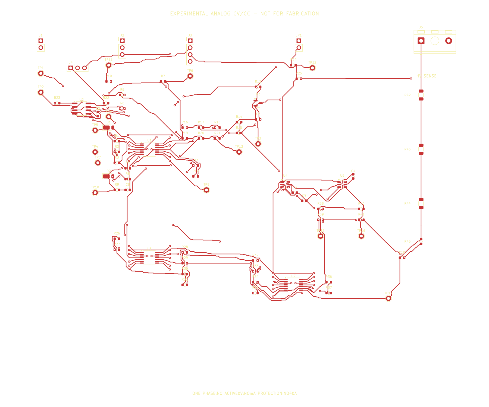
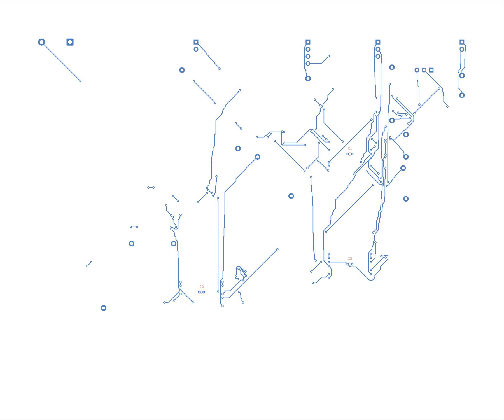

# Styrekortets placering og routing

Dette er layoutet til det eksperimentelle analoge CV/CC-styrekort. Kortet
indeholder kun måle- og styresignaler; belastningsstrømmen løber gennem den
eksterne Kelvin-shunt. Regulering, fejlrespons og opstart er ikke målt på hardware.

`scripts/control_route.py` køres efter `scripts/control_gen.py`. Først placeres
komponenterne efter funktion, derefter routes forbindelser i to kobberlag. Scriptet
bevarer alle referencebetegnelser, værdier, footprintvalg, net og diagramstier.
Det kræver `/usr/bin/python3`, KiCad 9, NumPy og en C++-kompiler. Den lille
A*-hjælper i `scripts/control_route_grid.cpp` kompileres i `.runtime`.

INA240 og de to 0-ohm Kelvin-forbindelser ligger nær J4. OPA4192 har CV-, CC- og
kompensationskomponenterne omkring sig. Afkoblingskondensatorerne ligger ved
deres respektive IC'er. C1, C5 og C6 sidder på bagsiden direkte under de tre
quad-IC'er: dedikerede vias ved kondensatorens terminaler forbinder de to
forsyningsben gennem korte lokale løkker. Reference, overvågning og komparatortærskler grupperes
hver for sig. Det højere spændingssignal kommer ind ved J5 i højre kant og går
lodret gennem R42–R44; kobberet skal holdes adskilt fra den øvrige elektronik.

Routing anvender 0,25 mm signalspor og 0,8/0,4 mm gennemgående vias. Den søger
med ekstra geometrisk margin, men dens egen kollisionskontrol er ikke en
godkendelse. KiCads fulde DRC med diagramkontrol bestemmer resultatet, som
gemmes i `exports/control/drc_routed.json` og `routing_summary.json`. Eventuelle
åbne forbindelser eller fejl skal forblive synlige i rapporten. Der produceres
ingen produktionsfiler.

De almindelige spor må ikke bruges til effektstrøm. Kortet har heller ingen
galvanisk isolation til den flydende sekundærs PGND. Den almindelige 0,25 mm
signalafstand og den særskilte 3 mm HV-regel er layoutkrav; deres tilstrækkelighed
for miljø, printmateriale og slutprodukt er endnu ikke kvalificeret. De tre
HV-modstandes præcise terminalpar har 1,5 mm lokal undtagelse, fordi et standard
1206-footprint ikke giver 3 mm mellem terminalerne. Fabrikantens arbejds- og
fejlspændingsdata skal stadig godkendes.

Den routede version har 86 komponenter, 211 tilsluttede terminaler og 41 net på
et 180 × 150 mm kort i to kobberlag. KiCads kontrol med alle alvorlighedsgrader
gav nul DRC-overtrædelser, nul åbne forbindelser og nul afvigelser fra diagrammet.
ERC og den uafhængige sammenligning mellem diagram, PCB og styrekortets BOM bestod.
Disse resultater gælder CAD-filerne. Der er ikke udført fysiske målinger.

En separat negativ kontrol øgede alene HV-reglen til 100 mm i en midlertidig
kopi. KiCad afviste kopien med exitkode 5 og registrerede 499 clearancefejl.
Det viser, at HV-reglen faktisk bliver anvendt. SHA-256-kontrollen bekræftede,
at de originale PCB-, projekt- og regelfiler forblev uændrede. Se
`exports/control/layout_validation.json`. To på hinanden følgende routinger
gav samme 2362 sporsegmenter, 154 vias og nul åbne forbindelser.

