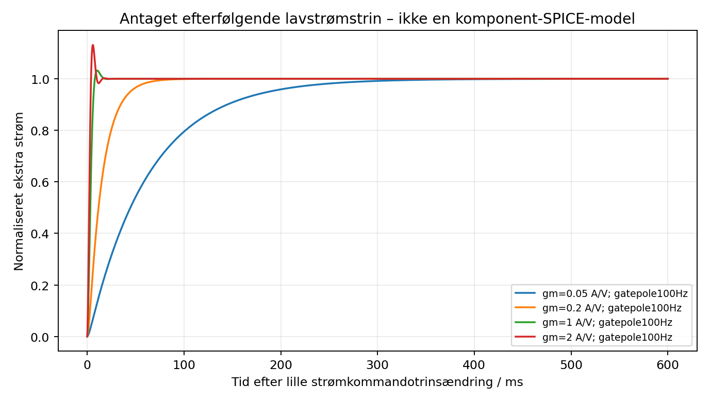

# Dynamisk undersøgelse af et separat lavstrømstrin

Dette appendiks supplerer dimensioneringen af 20 mA-/200 mA-områderne. Det er en **lineær beregningsmodel med antaget effekttrin**, uden native pass-kredsløb, PCB eller transistor-SPICE-model. Den frigiver ingen kompensationsværdier i det eksisterende styrekort.

## Hvad modellen kan undersøge

Et serieelement efter bulk-kondensatorerne tænkes reguleret af en separat strømservo. Modellen beskriver en lille kommandotrinsændring omkring et aktivt driftspunkt: gatekommando → strømgain gm → Kelvin-shunt → INA190A3 → PI-regulator. Den repræsenterer ikke opstart fra slukket tilstand eller en fysisk kortslutning.

Den antagne gm varieres fra 0,05 til 2 A/V, og en antaget gatepol fra 100 Hz til 20 kHz. Sensorens 35 kHz pol følger INA190A3's **typiske** bandwidth ved databladets lastbetingelser, ikke en garanteret maksimal faultforsinkelse. PI-modellen har nul ved 1 kHz og ekstra pol ved 10 kHz. Integralforstærkningen er 3,142/s for 1 Ω og 31,416/s for 0,1 Ω. Det er modelparametre; en faktisk opamp-, R/C- og gatedriverrealisering mangler.

Scriptet beregner unity-crossover, fasemargin, lukkede poler og 1 %-indsvingning for 24 tilfælde. Det stopper ved ustabilitet eller flere unity-passager. Tallene ligger i `exports/analysis/low_current_loop.json`.

Den gennemførte parameterundersøgelse giver mindst **55,69° model-fasemargin** og op til **294 ms 1 %-indsvingning**. Den langsomme ende er en væsentlig begrænsning for beskyttelse af små kredsløb. Tallene gælder kun de angivne lineære antagelser; hverken fysisk stabilitet eller kortslutningsenergi er verificeret.



En langsom stabil servo er utilstrækkelig som eneste beskyttelse. Gm, gatekapacitans, bias, temperatur, sensorforsinkelse og DUT kan ændre det virkelige respons. Der kræves separat hurtig overstrømsafbrydelse med dokumenteret maksimal reaktionstid og energi. Kondensatoren **efter** serieelementet kan stadig aflade direkte i DUT, selv hvis strømservoen er ideelt stabil.

## Konkret pass-kandidat og dens begrænsning

Infineon IPP110N20N3 G, 200 V TO-220, er en undersøgelseskandidat uden ændring af BOM eller CAD. Original Rev. 2.3, figur 3 på side 4, viser en DC-SOA-kurve ved case 25 °C. Ved 100 V kan omkring 0,3 A aflæses grafisk. Det er en omtrentlig grafaflæsning under den kolde testbetingelse, ikke en præcis varm strømgaranti.

100 V-kortslutning giver 2 W ved 20 mA og 20 W ved 200 mA. Begge ligger under den kolde kurve, men 200 mA har kun omtrent 1,5 gange grafisk strømmargin. θJC højst 0,5 K/W giver 10 K junction–case ved 20 W; interface og køling kommer oveni. En varm DC-SOA, termiske hotspots, arbejdsområde, driverfejl og kortsluttet pass-element skal kvalificeres. Almindelig temperatur-/effektskalering af 25 °C-kurven er ikke et bevis for lineær stabilitet. Fabrikantens note om lineær drift er arkiveret som `references/INFINEON_LINEAR_SOA.pdf`.

20 mA-sporet er en realistisk undersøgelsesretning; 200 mA ved kontinuert 100 V short er **ikke kvalificeret**. En reguleringsmargin fra upstream-bus, faktisk DUT-CV-feedback, galvanisk/flydende gateforsyning, pass-gate default OFF, reverse-blocking og uafhængig maksimum-DUT-spænding mangler stadig. De kan ikke erstattes af et grønt modelresultat.

## CV/CC-overgang og slukning

To regulatorers gatekrav skal kombineres med en dokumenteret selector, anti-windup og tracking, så den inaktive sløjfe følger det aktive drive. 0 A skal fysisk afbryde udgangen. 0 V kræver afbrydelse og en dimensioneret afladningsvej med målt restspænding. Rangeændring tillades først efter OFF og verificeret afladning. Disse funktioner er krav uden implementerede kredsløb i dette appendiks.

```sh
/usr/bin/python3 scripts/low_current_loop.py
```
