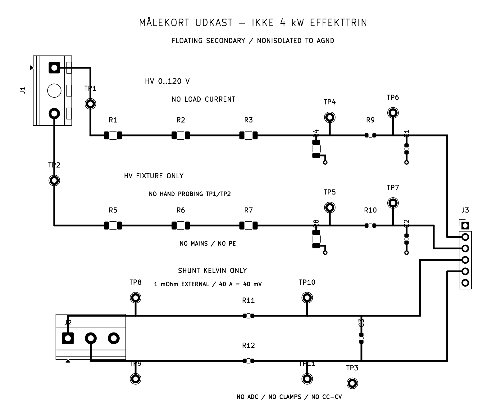
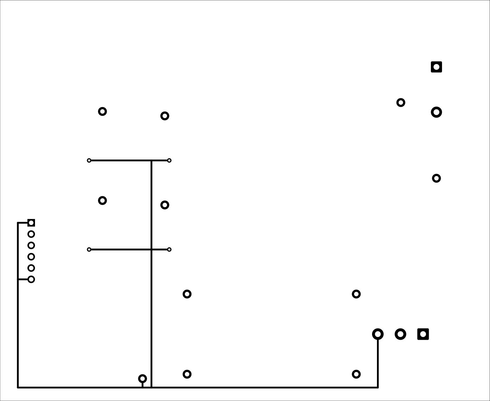

# Dansk manual – måle- og testkort

Revision: konstruktionsudkast opdateret 10. oktober 2026.

## 1. Hvad denne revision indeholder

Dette er manualen til det konkrete passive måle-/testkort, som indgår i projektet for en isoleret, flydende 0–100 V / 0–40 A laboratorieforsyning med 230 V AC / 32 A indgang.
Kortet har ingen regulator, ADC, strømbegrænsning, nettilslutning eller egen isolation. Det er ikke det færdige 4 kW-effektprint. Det kan klargøres og afprøves ved lav spænding, mens netdel, buck-regulator, CV/CC-sløjfer og hardwarebeskyttelser færdigprojekteres.

Kortet må kun befinde sig på den isolerede DC-sekundærside. AGND er den isolerede DC-bus' retur, på den lave side af en ekstern strømshunt. AGND er ikke beskyttelsesjord, og et jordet oscilloskop eller USB-interface kan ophæve den ønskede flydende udgang. PC-/instrumentforbindelser skal indgå i det endelige isolationsdesign.

## 2. Hvordan den samlede strømforsyning skal fungere

Den projekterede energivej er:

1. 230 V AC gennem en dimensioneret netbeskyttelse, netfilter og startstrømsbegrænsning.
2. En galvanisk isoleret AC/DC-del leverer en mellemspænding; 120 V er indtil videre kun et beregningspunkt.
3. Fire forskudte buck-faser skal dele op til 40 A og regulere udgangen til den indstillede spænding.
4. CV-reguleringen holder spændingsindstillingen, indtil lasten vil trække mere end strømgrænsen. CC-reguleringen sænker derefter udgangsspændingen for at holde den indstillede strøm.
5. Hardwarebeskyttelser skal kunne slukke gates og afbryde udgangen uafhængigt af software. Udladning reducerer resterende terminalspænding efter afbrydelse.

Disse fem blokke er krav og arkitektur. Et separat, uafsluttet LTC3779-effektfaseudkast findes nu i `design/power/`; det er fast indstillet omkring 100 V, designpunkt 10 A og uafsluttet PCB. Blokkene er endnu ikke en komplet 4 kW konstruktion i dette projekts KiCad-filer. Målekortet nedenfor leverer kun filtrerede målesignaler; det håndhæver ingen af grænserne.

## 3. De konkrete komponenters funktion

| Referencer | Værdi / udførelse | Funktion |
|---|---|---|
| R1, R2, R3 | 130 kΩ, 0,1 %, 1206 | Serieforbundet øverste del af spændingsdeleren for OUT+. Fordeler spændingen og begrænser strømmen efter inputstikket. |
| R4 | 10 kΩ, 0,1 %, 1206 | Nederste del af OUT+-deleren mod AGND. Sammen med 390 kΩ giver den 40:1 deling. |
| R5, R6, R7 | 130 kΩ, 0,1 %, 1206 | Samme funktion for OUT−. |
| R8 | 10 kΩ, 0,1 %, 1206 | Nederste del af OUT−-deleren. |
| R9, R10 | 1 kΩ, 1 %, 0603 | Seriemodstande mellem delere og spændingsmåleudgange. Indgår sammen med delerens impedans i filtreringen. |
| C1, C2 | 10 nF, 50 V, 0603 | Filtrerer hver spændingsmåleudgang mod AGND. Brug en serie med dokumenteret kapacitans ved den aktuelle bias; C0G foretrækkes til reproducerbar filtrering. |
| R11, R12 | 1 kΩ, 1 %, 0603 | Modstand i hver Kelvin-signalvej. De fører kun målestrøm. |
| C3 | 10 nF, 50 V, 0603 | Differentialfilter mellem de filtrerede Kelvin-signaler. |
| J1 | 2-polet spændings-sense-stik | OUT+ og OUT− måles via separate tynde, beskyttede senseledninger. Ikke en effektforbindelse. |
| J2 | 3-polet Kelvin/reference-stik | Shuntens to målepunkter og AGND. Ikke en effektforbindelse. |
| J3 | 6-polet signalheader | Filtrerede spændings- og strømsignaler til højimpedant måleelektronik, som endnu ikke er valgt. |
| TP1–TP11 | Testpads | Adgang til noderne i tabellen nedenfor. |
| Ekstern shunt | 1 mΩ, fire terminaler, ≥10 W, ≥50 A DC | Fører belastningsstrøm uden for målekortet og omsætter den til en lille Kelvin-spænding. Fabrikat og model er endnu ikke valgt. |

De endelige indkøbsnumre skal bekræftes i producentdatablade. Et footprintnavn eller en generisk værdi er ikke alene et frigivet indkøbsvalg. BOM'en skelner mellem monterede kortkomponenter, den eksterne shunt og uafklarede effektkomponenter.

## 4. Stik og forbindelser

| Stik / ben | Net | Tilslutning |
|---|---|---|
| J1.1 | POS_SENSE | OUT+ ved udgangsterminalen |
| J1.2 | NEG_SENSE | OUT− ved udgangsterminalen |
| J2.1 | KELVIN_PLUS | Shuntens Kelvin-punkt på OUT−-siden |
| J2.2 | KELVIN_MINUS | Shuntens Kelvin-punkt på DC-busretur-siden |
| J2.3 | AGND | Separat signalreference fra DC-busretur |
| J3.1 | AGND | Signalreference |
| J3.2 | VMON_PLUS | Filtreret OUT+ / 40 |
| J3.3 | VMON_MINUS | Filtreret OUT− / 40 |
| J3.4 | IMON_PLUS | Filtreret Kelvin+ |
| J3.5 | IMON_MINUS | Filtreret Kelvin− |
| J3.6 | AGND | Signalreference |

Positive og negative Kelvin-ledninger føres som et snoet par helt til shuntens dedikerede sense-terminaler. Ingen 40 A-strøm må løbe gennem J1, J2, J3 eller målekortet. Et forbindelsespunkt på kraftkablet erstatter ikke en Kelvin-terminal.

Det separate eksperimentelle styrekorts INA240 bruger egne direkte Kelvin-ledninger til shunten. Forbind ikke dets strømindgange til dette målekorts J3.4/J3.5 gennem de eksisterende 1 kΩ filtermodstande: INA240's inputbias og et ubalanceret filter kan give væsentlige målefejl. Se `docs/control.md` for den aktuelle styrekortforbindelse.

Senseledningerne skal have en dokumenteret strøm-/fejlenergibegrænsning ved kraftkilden. Seriemodstandene på kortet beskytter ikke en ledning, som kortsluttes før kortet. Dette beskyttelseskredsløb er endnu ikke dimensioneret.

## 5. Spændingsmålingen og beregninger

For hver deler er R_top = 3 × 130 kΩ = 390 kΩ og R_bottom = 10 kΩ:

V_sense = V_input × 10 / (390 + 10) = V_input / 40.

Udgangens terminalspænding beregnes nominelt som:

V_out = 40 × (VMON_PLUS − VMON_MINUS).

Ved 100 V mellem terminalerne og 40 A gennem en 1 mΩ lavside-shunt er OUT− cirka 40 mV over AGND. OUT+ er derfor cirka 100,040 V over AGND. VMON_PLUS er nominelt 2,501 V, VMON_MINUS 1,000 mV, og differensen ganget med 40 bliver 100 V.

Hvert sense-input skal i første prototype ligge mellem 0 og 120 V i forhold til AGND. 120 V giver 3,000 V ved deleren. At måle en flydende udgang kræver stadig, at dette interne common-mode-krav overholdes.

Ved 120 V løber 0,300 mA i deleren. Hver 130 kΩ modstand taber 39 V og dissipaterer 11,7 mW; 10 kΩ modstanden dissipaterer 0,9 mW. Den valgte modstandsserie skal dokumentere mindst disse spændinger med passende margin, temperatur og renlighed.

Selv 0,1 %-modstande giver cirka ±0,195 % worst-case ratiofejl. Det svarer til omtrent ±195 mV ved 100 V før kalibrering. Derfor er kortet ikke automatisk et præcisionsvoltmetre.

Delerens udgangsimpedans er 390 kΩ || 10 kΩ = 9,75 kΩ. Inklusive R9/R10 er den cirka 10,75 kΩ. Med 10 nF bliver filterets grænsefrekvens cirka 1,48 kHz. En måleindgang på 10 MΩ giver yderligere cirka 0,107 % belastningsfejl; en 1 MΩ indgang giver cirka 1,06 %. ADC'ens acquisition-tid og inputlækage skal verificeres eller en buffer tilføjes i et senere styringskort.

## 6. Strømmålingen

I_out = (IMON_PLUS − IMON_MINUS) / 0,001 Ω.

| Strøm | Shuntspænding | Shunteffekt |
|---:|---:|---:|
| 40 A | 40 mV | 1,6 W |
| 10 A | 10 mV | 0,1 W |
| 0,5 A | 0,5 mV | 0,25 mW |
| 20 mA | 20 µV | 0,4 µW |

Det sidste signal er meget lille. Det planlagte lavstrømsområde kræver et andet måleområde, lav offset, kalibrering og en hurtig analog strømbegrænsning. Dette kort har hverken forstærker eller ADC og leverer derfor ikke den ønskede strømbegrænsning alene.

R11 + R12 = 2 kΩ og C3 = 10 nF giver cirka 7,96 kHz differential grænsefrekvens. Filteret er til måling, ikke til hurtig kortslutningsbeskyttelse. Et regenerativt eller omvendt tilsluttet kredsløb kan give negativ strøm og negative målesignaler; dette er ikke en understøttet driftsform i denne prototype.

## 7. Testpunkter

Medmindre andet står, refereres spændingsmålinger til TP3 = AGND.

| TP | Net | Forventet niveau ved 100 V / 40 A |
|---|---|---|
| TP1 | POS_SENSE | Cirka 100,040 V. Høj spænding; differentialinstrument med passende rating. |
| TP2 | NEG_SENSE | Cirka 40 mV; kan blive høj ved fejl i kraftdelen. |
| TP3 | AGND | Isoleret DC-busretur; ikke PE. |
| TP4 | VS_PLUS | Cirka 2,501 V før R9/filter |
| TP5 | VS_MINUS | Cirka 1,000 mV før R10/filter |
| TP6 | VMON_PLUS | Cirka 2,501 V ved høj måleimpedans |
| TP7 | VMON_MINUS | Cirka 1,000 mV ved høj måleimpedans |
| TP8 | KELVIN_PLUS | Cirka 40 mV |
| TP9 | KELVIN_MINUS | Nær 0 V i forhold til AGND |
| TP10 | IMON_PLUS | Cirka 40 mV ved høj måleimpedans |
| TP11 | IMON_MINUS | Nær 0 V ved høj måleimpedans |

Tallene er beregnede nominelle værdier, ikke målinger. Højimpedante sensepunkter kan vise transiente fejlspændinger; et lavt normalt niveau betyder ikke, at proben må have lav spændingsrating.

## 8. Første prøve uden kraftforsyningen

1. Kontrollér referencebetegnelser, lodning og stikretning mod KiCad-skema og BOM. Kontrollér R1–R8 før montering af eventuel ADC.
2. Kortet frakobles fuldstændigt fra netdel, effektbus, belastning og ADC. Brug en separat strømbegrænset lavspændingskilde.
3. Forbind kildens minus til AGND og NEG_SENSE. Påfør 10,000 V til POS_SENSE. TP4 og TP6 skal være cirka 0,2500 V, korrigeret for instrumentets inputimpedans og modstandstolerance.
4. Flyt 10 V til NEG_SENSE med POS_SENSE til AGND. TP5 og TP7 skal give samme nominelle ratio. De to kanaler prøves separat; dette trin efterligner ikke normal terminalpolaritet.
5. Kontrollér Kelvin-filteret med en lavenergi differentialkilde på eksempelvis 10 mV. TP10 − TP11 skal nærme sig 10 mV i stationær tilstand ved højimpedant instrumentering.
6. Kontrollér de afbrudte og kortsluttede modstandsscenarier ved højst 10 V med en dokumenteret lavenergi testfixture. Tilslut ingen uprøvet ADC eller 120 V kilde for at gøre en sådan fejltest. En afbrudt R4/R8 kan hæve måleudgangen og den tilhørende 50 V kondensator mod fuld inputspænding; dette er en uløst enkeltfejl i det passive kort. Frakobl input før fejlsøgning. Den færdige målekæde kræver verificeret clamp/fejlhåndtering.
7. Notér offset, ratio og instrumentmodel for begge kanaler. De faktiske resultater føres i en separat testjournal.

Disse prøver er endnu ikke udført fysisk. Ingen 40 A-last kræves for at verificere det passive korts grundfunktion.

## 9. Fejlfinding

| Symptom | Sandsynlig årsag | Mål / handling |
|---|---|---|
| Begge spændingskanaler viser 0 | Manglende input eller reference | Kontrollér J1 og J2.3; mål kilden med egnet instrument. |
| Input korrekt, TP4 nul | Afbrudt R1–R3 eller kortsluttet R4 | Frakobl og aflad kraftdelen; mål modstandskæden. |
| TP4 korrekt, TP6 forkert | R9 afbrudt, C1 kortsluttet eller måleindgang belaster | Afprøv uden efterfølgende målekort og sammenlign TP4/TP6. |
| Kanalen viser for høj værdi | R4/R8 afbrudt, forkert værdi eller lækage | Frakobl eventuel ADC straks; kontrollér delerens nederste modstand. |
| Kun OUT−-målingen er forkert | R5–R8 eller forkert AGND/Kelvin-reference | Sammenlign TP2, TP5 og TP7. |
| Negativ strømaflæsning | Ombyttede Kelvin-ledninger eller tilbageført strøm | Kontrollér J2.1/J2.2 og den faktiske energiretning. |
| Strøm afhænger af kraftkablets spændingsfald | Kelvin-ledninger taget fra kabel i stedet for shunt | Flyt begge til shuntens dedikerede sense-terminaler. |
| Støj på strømsignal | Lang målesløjfe, common-mode-støj eller kobling fra switch-node | Kontrollér snoet Kelvin-par og signalreference; C3 dæmper kun differentialstøj. |
| Målingen ændres med oscilloskopet | For lav inputimpedans eller jordning af flydende udgang | Brug passende differential-/isoleret måling og ret impedans. |
| Små print får skade trods lav strømindstilling | For høj spænding, restenergi eller begrænserens forsinkelse | Dette målekort kan ikke løse fejlen; verificér separat udgangsbeskyttelse og lavstrømsregulator. |

## 10. Hvad der stadig skal konstrueres

Net-/isoleringsdel, konkret buck-controller med fire faser, magnetik, MOSFET'er, gate-drivere, aktive CV/CC-sløjfer, lave strømområder, setpunkter, ADC/PGA, hardware-fejlstop, udgangsafbrydelse, udladning, køling og mekanisk kabinet.
Producentdatablade for de valgte købskomponenter skal gennemgås, inden footprints, pinout, clearance og indkøb frigives. ERC og DRC undersøger CAD-forbindelser og geometri, ikke elektrisk/termisk funktion ved 4 kW.

## 11. Målekortets PCB-oversigt

Kortet er 110 × 90 mm med to kobberlag. J1 ligger ved senseindgangen, J2 ved Kelvin-/referenceindgangen og J3 ved de filtrerede måleudgange. Billederne viser det routede native PCB; de er reviewvisninger og ingen fabrikationsfrigivelse.

