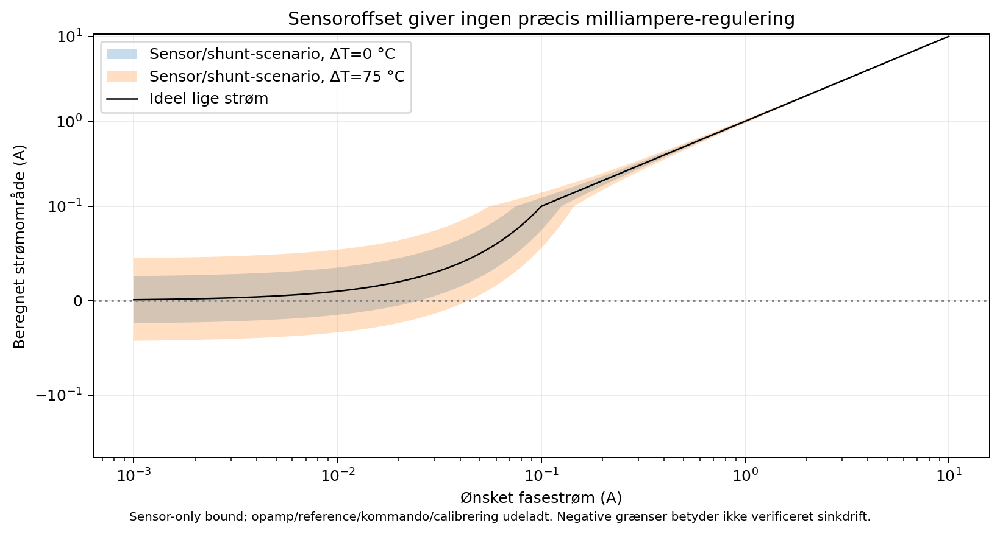
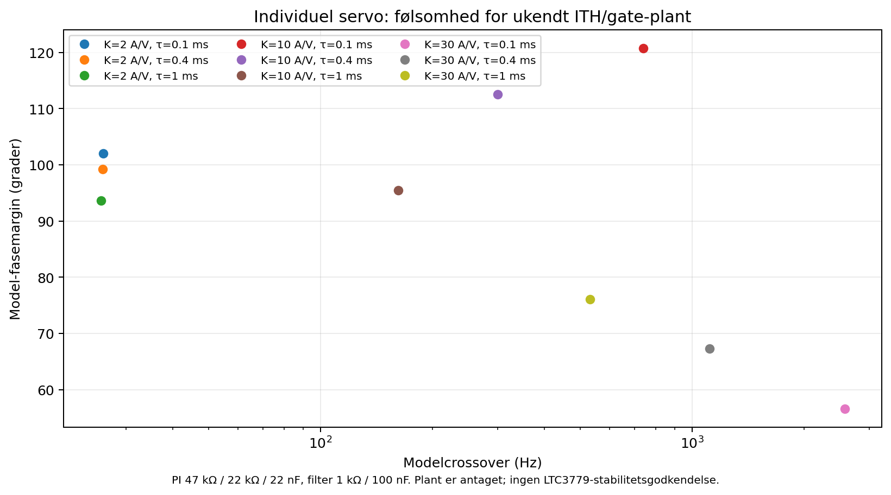
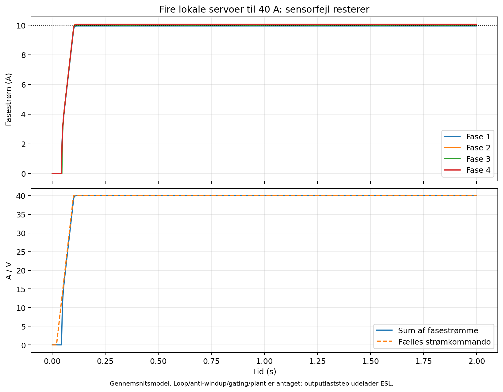
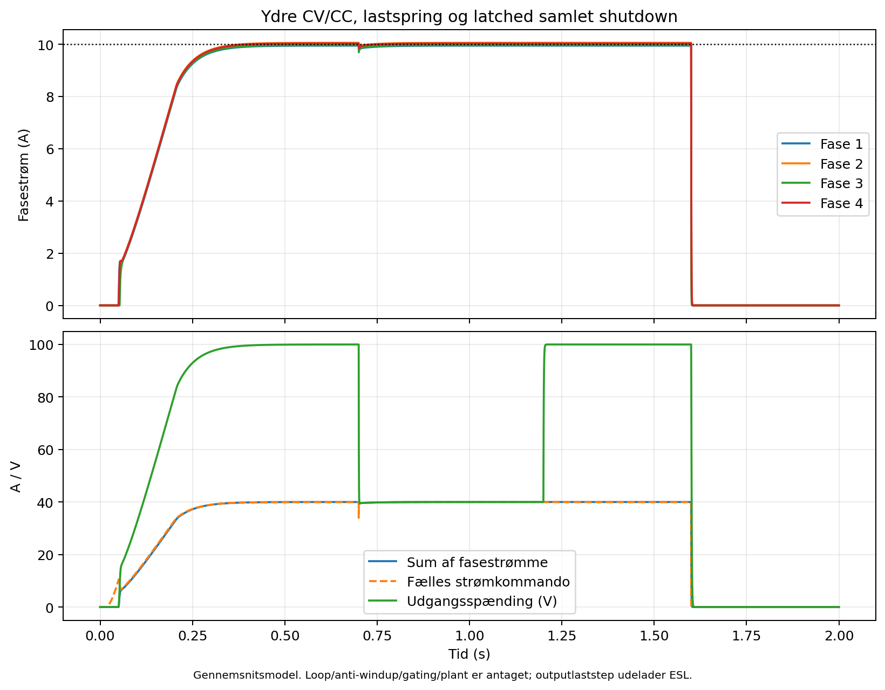
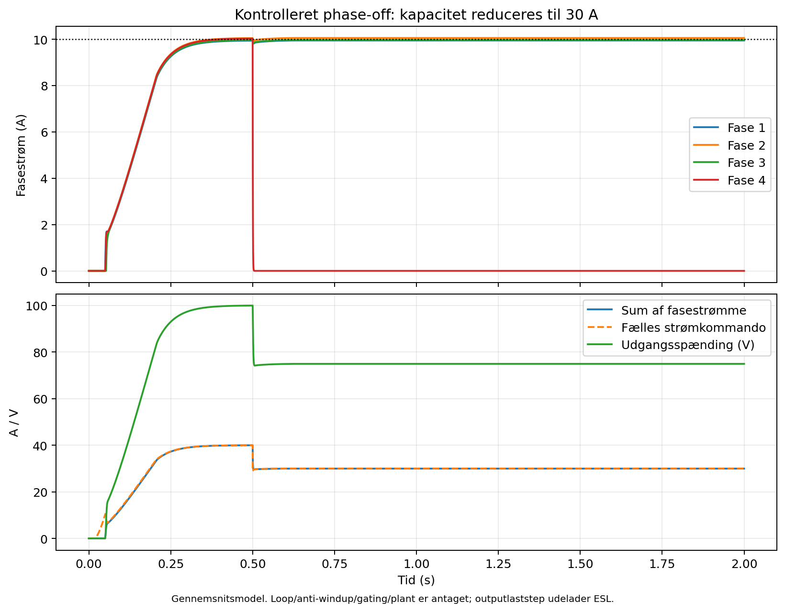

# Fire uafhængige fasestrømsservoer

Dette forslag bruger **fire egne phasesensorer, PI-sløjfer og ITH-sinkaktuatorer** samt én fælles ydre CV-/total-CC-kommando. Hver fase korrigerer sin egen strøm efter feedback. ITH, SS og V5 forbindes ikke mellem controllerne. Dermed er fælles valley-kommando ikke længere den eneste mekanisme til strømfordeling.

Der er nu et native **énkanals studieskema**, en særskilt BOM og en reproducerbar firekanals gennemsnitsmodel. Studiet er **ikke integreret i de eksisterende routede effekt-/styrekort**. Anti-windup, OFF-tracking, command-gating, RUN-supervision og fejllåsning er nødvendige blokke, som endnu ikke er implementeret i studieskemaet. Hardwaretest: **0**.

## Filer og reproduktion

- Native studie: design/control/studies/phase_sensor_study.kicad_sch.
- PDF: exports/control/studies/phase_sensor_study.pdf.
- Lokal symboldefinition: design/control/studies/PhaseBalanceStudy.kicad_sym.
- Énkanals BOM: bom/phase-balancing-study.csv, **47 fysiske referencer**.
- Model: scripts/phase_balance_analysis.py.
- Resultater: exports/analysis/phase_balance.json og fem PNG-/PDF-plotpar.
- Originalkilder og hashes: references/phase-balancing-sources.json.

Fra projektroden køres modellen med /usr/bin/python3 scripts/phase_balance_analysis.py. Studieskema/BOM/netliste/ERC regenereres med /usr/bin/python3 design/control/studies/generate_phase_sensor_study.py.

Der oprettes intet nyt overordnet KiCad-projekt. Studiet er standalone under design/control/studies. KiCad 9 CLI læser ikke den lokale symboltabel til ERC uden en projektcontainer; generatoren bruger derfor en identisk kopi med en **midlertidig tom .kicad_pro i /tmp**, som slettes igen. Standalone åbning kan vise bibliotekadvarsler; symbolerne er indlejret, og lokal tabel medfølger.

## Arkitektur og reguleringsfortegn

Den foreslåede strømvej pr. fase er: LTC3779-effekttrin → eksisterende 4 mΩ IAVG-shunt → ny 2 mΩ phaseshunt → fælles udgang/bulk → DUT. Placering af bulk og Kelvin-reference skal sikre, at phasesensoren måler den relevante outputgren, inklusive strøm til den fælles outputkapacitet. Stor lokal kapacitet foran phasesensoren ændrer signal og plant.

Den nye 2 mΩ-shunt **erstatter ikke den eksisterende 4 mΩ IAVG-shunt**. En sådan erstatning ville hæve den native IAVG-grænse fra omtrent 12,5 til 25 A og indgår ikke i forslaget.

Hver kanal fungerer således:

1. AMC3302 måler sin egen 2 mΩ-shunt.
2. OPA4192A konverterer signalet til VMON = 1,25 V + 0,082 V/A × Iphase.
3. Den lokale kommando er ICMD = 1,25 V + 0,082 V/A × ønsket phasestrøm.
4. For høj målt strøm øger PI-output og NMOS-gate.
5. NMOS trækker **kun lokal ITH ned**. Controllerens current-threshold reduceres, og strømmen falder.

Fortegnet er negativ feedback: Iphase op → VMON op → gate op → ITH ned → Iphase ned. Når strømmen er for lav, mindskes sink. Der findes ingen ekstern positiv spændingskilde, diode fra AUX5 eller bufferudgang, som løfter ITH.

Den ydre regulator beregner totalstrømkommando ud fra CV-fejl og separat **samlet DUT-strømmåling**. Modellen vælger den mindste kommando fra CV og total-CC med anti-windup. En allocator fordeler min(Itotal, 10 A × Nactive) / Nactive. Hver fase beholder egen PI/aktuator; den fælles kommando er ikke en fælles analog ITH.

Kommandogenerator, DAC-/analogfordeling, samlet måling og systemguards er ikke tegnet som et integreret firefasekort.

## Sensor ved 100 V common mode

**INA240 kan ikke bruges direkte high-side ved 100 V**: det originale TI-datablad angiver −4 til 80 V common mode. Den kan fortsat indgå i en egnet low-side-måling, men løser ikke denne sensorplacering.

Studiet vælger **AMC3302DWE**, verificeret i det faktisk hentede originale TI-datablad **SBASA11B, juli 2021**. Egen isoleret DC/DC forsyner inputdelen; kontrolsiden får 3,0–5,5 V fra PSU'ens flydende sekundærside.

| Parameter | Verificeret fabrikantdata | Betydning |
|---|---|---|
| Linear input | ±50 mV | 2 mΩ giver ±25 A måleområde |
| Gain | 41 V/V | Differential output 82 mV/A |
| Output common mode | 1,39–1,49 V; typisk 1,44 V | OUTP/OUTN behandles som differentialpar |
| Inputoffset, 25 °C | ±50 µV maksimum | ±25 mA ækvivalent ved 2 mΩ |
| Offsetdrift | ±0,5 µV/°C maksimum | Nulstrømsusikkerhed vokser med temperatur |
| Gainfejl / drift | ±0,2 % / ±35 ppm/°C | Kalibrering og temperaturbudget kræves |
| Bandwidth | mindst 290 kHz | Intet selvstændigt bevis for OCP-reaktionstid |
| Startup til valid output | 1,4 ms maksimum | RUN holdes slukket under kvalifikation |
| DIAG | Aktiv-lav, open-drain | Lav ved startup/DC/DC/high-side-LDO-fejl |
| Failsafe differentialoutput | −2,63 til −2,53 V | Fejlsignal, ikke almindelig negativ strøm |
| Isolation working | 1200 VRMS / 1700 VDC i databladets tabel | PCB/montage skal stadig kvalificeres |

HGND har en **separat Kelvin-retur** til shuntens downstream terminal ved fælles positiv VOUT. INN har sin egen 10 Ω sensevej til samme terminal. PGND er flydende sekundærretur, ikke PE. **HGND og PGND må ikke kortsluttes** af print, interface eller måleudstyr.

| AMC3302-ben | Funktion | Faktisk studienet |
|---:|---|---|
| 1 / 3 | DCDC_OUT / HLDO_IN | ISO_DC, direkte sammen |
| 2 / 8 | DCDC_HGND / HGND | HGND |
| 4 | NC | HGND, tilladt af databladet |
| 5 | HLDO_OUT | ISO_LDO, egen afkobling |
| 6 / 7 | INP / INN | Egne 10 Ω Kelvin-/filterveje |
| 9 / 15 | GND / DCDC_GND | PGND |
| 10 / 11 | OUTN / OUTP | Matchet differensforstærker |
| 12 | VDD | AUX5 |
| 13 / 16 | LDO_OUT / DCDC_IN | LV_DC, direkte sammen; ingen ekstern LDO-belastning |
| 14 | DIAG | 47 kΩ pull-up og separat fault-overvågning |

C1–C8 følger TI figur 9-1: ISO_DC får 1 µF, 100 nF og 1 nF; ISO_LDO får 100 nF og 1 nF; low-side DC/DC får 100 nF; VDD får 1 µF og 1 nF. Endelige capacitor-MPN'er, effektiv kapacitet og layout mangler. R3 er 0 Ω Kelvinlink; eventuel TI-anbefalet EMI-ferrit skal vurderes for parasitter og DC-modstand.

SH1 er **2 mΩ / 0,1 %, mindst 3 W, mindst 25 A, højst 15 ppm/°C** som krav. Tab ved 10 A er 0,20 W, ved 25 A 1,25 W. Fire-terminalopbygning, derating, mindst 200 V arbejdsrating og MPN mangler. Det grafiske to-ben-symbol er strømvejens repræsentation, ikke et frigivet fire-pad landpattern.

## Lokal PI og sink-kandidat

R5–R8 er ratio-matchede 10 kΩ med foreløbigt 0,01 % ratio-krav. Ideelt giver OPA4192A: VMON_RAW = OUTP − OUTN + VREF. OPA4192C bufferer eksternt kvalificeret 1,25 V. Referencegenerator/fejlbudget er ikke skjult implementeret.

R9 = 1 kΩ og C10 = 100 nF giver 1,59 kHz målefilterpol. PI-startværdierne er R10 = 47 kΩ, R11 = 22 kΩ og C11 = 22 nF. Det faktisk tegnede non-inverting kredsløb følger:

Vgate = VMON + (R11/R10 + 1/(s × R10 × C11)) × (VMON − ICMD).

Målesignalets P-faktor er **1,468**, kommandoens P-faktor **0,468**, og integralfaktoren **967,1 s⁻¹**. Modellen bruger disse forskellige koefficienter.

Q1 er **CSD13381F4**, kontrolleret i originalt TI-datablad **SLPS448F, januar 2022**: 12 V VDS, 8 V gateabsolute, højst 180 mΩ ved 4,5 V og 0,5 A/25 °C. Gate drives fra 5 V opamp gennem 100 Ω med 100 kΩ pulldown. Drain går gennem 470 Ω til lokal ITH; source til PGND.

Den lille 1,0 × 0,6 mm Femto-kapsling har **intet frigivet footprint**. G1/S2/D3 er afledt af package-views og markeret for uafhængigt fysisk mapping-/landpattern-review. SOT-23-footprintet fra det grafiske 2N7002-basesymbol må ikke bruges til denne del.

Ved fuldt tændt NMOS og 5,7 V ITH giver 470 Ω en beregnet øvre resistiv strøm omkring 12 mA. **LTC3779-databladet giver ikke en garanteret maksimal ITH-source/clampstrøm.** Tallet beviser hverken faktisk strøm, gain eller myndighed. Opamp-railswing, MOSFET-transfer, native ITH-kompensation og CV/IAVG-interaktion kræver plantmåling.

## LTC3779 og fase-off

Databladet dokumenterer, at højere ITH giver højere current-threshold, og at native IAVG reducerer ITH ved overstrøm. Det begrunder sink-retningen, men kvalificerer ikke de eksterne servoer.

ITH, SS og PLLIN må ikke overskride **hver IC's lokale V5**. RUN-shutdown slukker V5/DRVCC. Fire NMOS-drains/ITH må derfor ikke forbindes sammen. PLLIN kræver egne kvalificerede buffers/gating, der holder signalet lavt, når lokal V5 er slukket. Clockforskydning er fortsat en særskilt ripple-/EMI-opgave.

Hver fase beholder lokal, kompenseret VFB-ceiling og native IAVG/cycle-grænser. **Eksisterende fast 99,6 V kan ikke via sink alene garanteres at levere 100 V.** Fremtidig variant skal beregne ceiling med reference-/divider-/tabsmargin og uafhængig OVP. Ingen eksisterende VFB-resistor er ændret.

Buck/boost, pulse skipping og tilbageført energi forsvinder ikke med de ekstra servoer. Negativ strøm og busenergi kræver systembeskyttelse; front-end antages ikke at kunne absorbere energi.

## Default OFF og nødvendige fejlblokke

R16 = 10 kΩ holder RUN omkring 25 mV ved typisk 2,5 µA start-pull-up, under 1,1 V shutdown. **RUN-enable-driver er ikke implementeret i studiet.**

Den fremtidige sekvens skal holde alle RUN lave, kvalificere AUX5/AUX12/reference/DIAG og lokale forsyninger, gate kommandoer ved railtab, tracke PI til dokumenteret fuld local clamp og frigive RUN/soft start/kommando bumpless. Anti-windup skal virke i begge railretninger. De konkrete reset-/track-/guard-komponenter mangler.

Uventet phase-/sensor-/aux-fejl skal give **latched shutdown af alle fire faser** samt afbrudt kommando og kontrolleret outputafbrydelse/discharge. RUN-stop aflader ikke outputbulk. Planlagt phase-off kan efter kvalificeret sekvens reducere kapaciteten til 30 A; en uventet fejl ved 40 A må ikke automatisk omfordele til 13,33 A pr. remaining phase.

DIAG opdager DC/DC-/high-side-forsyningsfejl, **ikke alle åbne Kelvinledninger**. TI advarer mod flydende INP/INN, hvis output kan blive ubestemt, mens DIAG stadig er høj. Sense-open/plausibilitet, reverse current, command validity, phase-OCP/OTP og fault-latch kræves derfor særskilt.

Et eksempel på mismatch-supervision er 0,5 A afvigelse i 5 ms, med hensyn til tolerance, ramp og ripple. Det er et **testscenarie**, ikke en valgt OCP-reaktionstid. Hurtig overstrøm og SOA skal have en egen dokumenteret vej; bandwidth/startup-settling beviser ingen maksimal fault-latency.

## Tolerance og lavlast

AMC3302 plus den foreslåede 0,1 %-shunt giver sensor-only gainbudget ±0,3 % ved 25 °C. Med ΔT = 75 °C, shuntkrav 15 ppm/°C og AMC 35 ppm/°C bliver scenariegrænsen ±0,675 %. Offset 50 + 75 × 0,5 = 87,5 µV svarer til **43,75 mA pr. fase**.

| Total / ideal fasestrøm | Sensor-only interval ved 25 °C | Interval med ΔT = 75 °C |
|---|---|---|
| 40 A / 10 A | 9,945–10,055 A | 9,889–10,112 A |
| 0,5 A / 125 mA | 99,7–150,5 mA | 80,7–169,9 mA |
| 40 mA / 10 mA | −15,0–35,1 mA | −33,5–54,1 mA |

Negative grænser er fejlbudgetregning, ikke verificeret sinkdrift. Opampoffset, ratio, reference, ICMD/DAC, filter, noise og kalibreringsrest er udeladt og skal tilføjes. Shunt-TCR er et krav uden valgt fysisk del.

Separate loops fjerner L/valley-betinget DC-ubalance i den idealiserede model, men sensorfejl resterer. Hvis alle sensorer underrapporterer, kan fire 10 A-kommandoer give over 40 A. Uafhængig total-CC/OCP med eget fejlbudget kræves.

Højstrømsfaserne er **OFF under 0,5 A total-kommando** som et eksplicit modelvalg. Det giver ingen aktiv lavstrømsforsyning; en separat path skal levere den funktion. Phase shedding alene giver ikke milliamperebeskyttelse og fjerner ikke outputenergi.

## Dynamisk model og resultater

Modellen har fire egne sensorfilter-, PI-, gate- og current-stater. Plantgain/poler/gate-ITH er **ukendte controllerdata**, erstattet af tydeligt antagne scenarier. Dette er ikke LTC3779-SPICE.

Den lokale plant er Irequest = clip(15 A − K × (Vgate−0,5 V), 0, 13,26 A), fulgt af førsteordens current-respons. 15 A og 0,5 V er tænkte operating-point-tal. Loftet 13,26 A er tidligere IAVG/shuntberegningsværdi, ikke en transientgaranti.

Ni loops varierer K = 2/10/30 A/V og current-tidskonstant 0,1/0,4/1 ms, med faktisk tegnet 1 kΩ/100 nF filter og antaget 0,5 switchperiode delay. Crossover bliver **25,7–2573 Hz**, margin **56,6–120,8°**. Worst-case blandt disse ni antagne cases er 56,6°. Extra poler, buck/boost, native kompensation eller anden gain kan ændre resultatet. Den langsomste case kræver en væsentligt langsommere ydre loop, indtil plant er identificeret.

Den nominelle transientmodel bruger gains 8/10/12/9 A/V, tidskonstanter 0,4/0,5/0,3/0,6 ms og tænkte sensorfejl. Ved 40 A konvergerer faserne til **9,946 / 10,055 / 9,968 / 10,032 A**. Plantforskelle korrigeres af de egne integratorer, mens sensorfejl forbliver.

Systemscenariet inkluderer ideal 384 µF output, resistiv last og fælles ydre CV/total-CC:

- Før lastspring: cirka 99,98 V / 39,99 A ved 2,5 Ω.
- Ved 0,7 s: last bliver 1 Ω; efter transient cirka **40,00 V / 40,00 A** i CC.
- Ved 1,2 s: last bliver 2,5 Ω; modellen vender tilbage til cirka 100 V / 40 A.
- Ved 1,6 s: phase-fejl giver modelleret **latched samlet OFF**.

Anti-windup, OFF-tracking, kvalifikation og latch er **antaget implementeret i modellen**, men mangler i native studiet. Kondensatorens momentane laststrøm er ikke phasesummen; ESL og nonlinear DUT er udeladt. Kurverne er ingen fysisk peak-/SOA-forudsigelse.

Ved planlagt trephase-drift begrænses kommandoen til 30 A. En 2,5 Ω last giver cirka **74,92 V og 29,97 A**, fordi strømkapaciteten ikke rækker til 100 V. Fase 4 er OFF; remaining phases får højst 10 A-kommando.

Et aktuator-modeksempel bruger K = 2 A/V og 5 V gategrænse: lavest kontrollerbare strøm med RUN aktiv bliver **6 A pr. fase** i den tænkte affine plant. Dette er ikke CSD13381F4-transferkurven. Selv god margin ved 10 A beviser ikke kontrol til 0 A. Faktisk ITH-sinkmyndighed skal måles; RUN-shutdown skal virke uafhængigt.

## Kontrol og komponentstatus

Native studie har **47 BOM-/XML-referencer og 113 kontrollerede pin-net-noder**. Tre virtuelle #FLG-powerflags udelades fra den fysiske BOM/netliste. ERC med alle alvorligheder i identisk midlertidig container: **0 fejl/advarsler**. Intet studie-PCB findes; DRC/routing/fabrication er ikke gennemført.

BOM Quantity = 1 er antallet vist i én kanal. Four_phase_required_quantity = 4 beskriver fire identiske kopier. Det er **ikke komplet 40 A system-BOM**: regulator, reference, gating, supervisors, anti-windup, latch, clock, outputafbryder/discharge og køling mangler. Q1/SH1/stik/resistornetværk/passivdele har tydelige MPN-/reviewbegrænsninger.

Fire AMC3302 kræver op til 160 mA fra deres low-side-forsyning ud fra 40 mA hver, plus opamp/reference/logic/guard. Hele hjælpekilden skal budgetteres sammen med gateeffekten i effektfaserne; et Mean Well-control-AUX-output er ikke automatisk hele PSU'ens hjælpeforsyning.

Tidligere power_analysis.py/resultater og eksisterende routede boards er bevaret. De nye numeriske checks omfatter sensor-scale/full-scale, allocatorgrænser, negative-command clamp, ikke-negative modelstrømme, model-currentloft, phasesummer og all-OFF efter fault. De viser intern modelkonsistens, ikke ufuldstændig hardwares funktion.

## Primærkilder

1. TI AMC3302 SBASA11B: https://www.ti.com/lit/ds/symlink/amc3302.pdf — s. 3 pinmap; s. 4 common mode; s. 6 isolation; s. 8–9 error/power/settling; s. 21 DIAG; s. 25–28 input/layout.
2. TI CSD13381F4 SLPS448F: https://www.ti.com/lit/ds/symlink/csd13381f4.pdf — s. 1/3 ratings; s. 8–9 package-/landpattern-views, fysisk review stadig åbent.
3. TI OPA192-familie SBOS620E: https://www.ti.com/lit/ds/symlink/opa192.pdf — s. 4–6 pinmap/supply; s. 10–11 low-supply-data.
4. ADI LTC3779 Rev A: https://www.analog.com/media/en/technical-documentation/data-sheets/ltc3779.pdf — s. 2 pin-grænser; s. 3 gm/threshold; s. 11 ITH; s. 14 RUN/V5; s. 15–18 current-mode/native IAVG.

AMC3302/CSD13381F4 er hentet via normal HTTPS. Nexperia-2N7002-forsøget gav HTTP 403, og denne del bruges **ikke** som verificeret komponentvalg. Dens symbol anvendes kun som NMOS-grafik med CSD13381F4 som værdi, fysisk mappingreview/footprint markeret uafsluttet.
