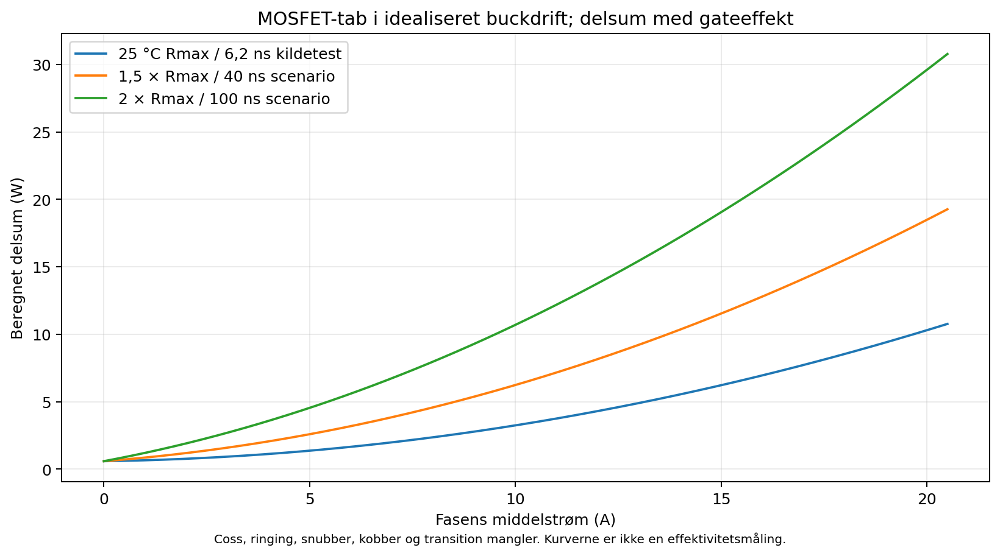
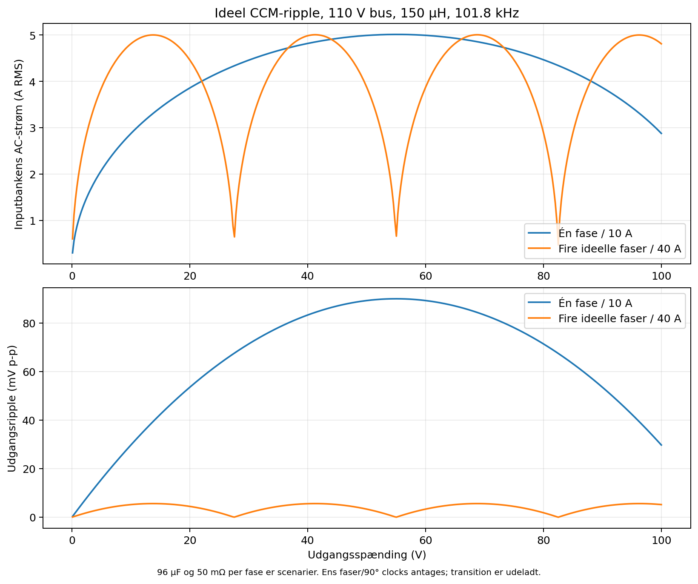
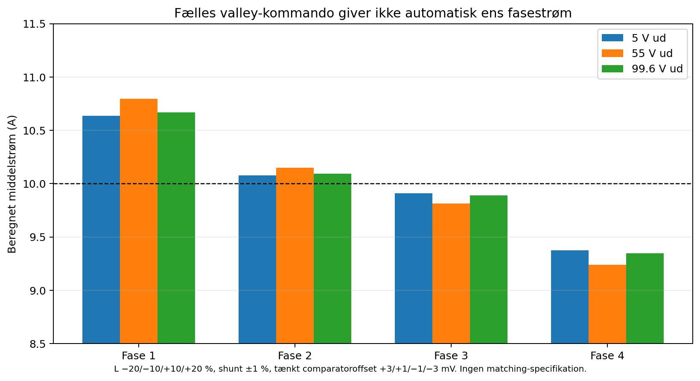
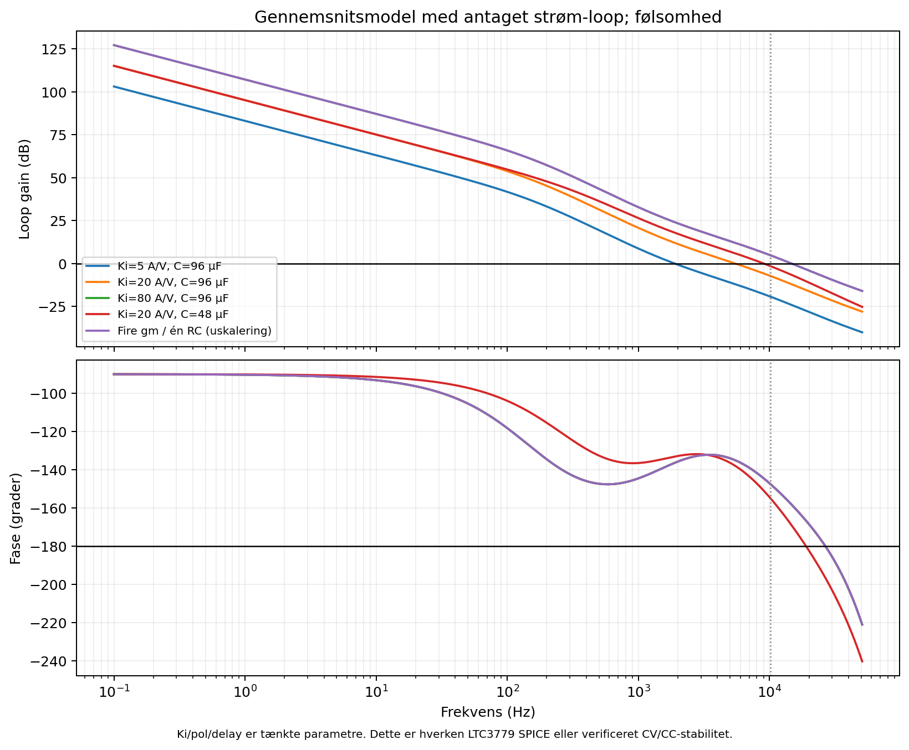
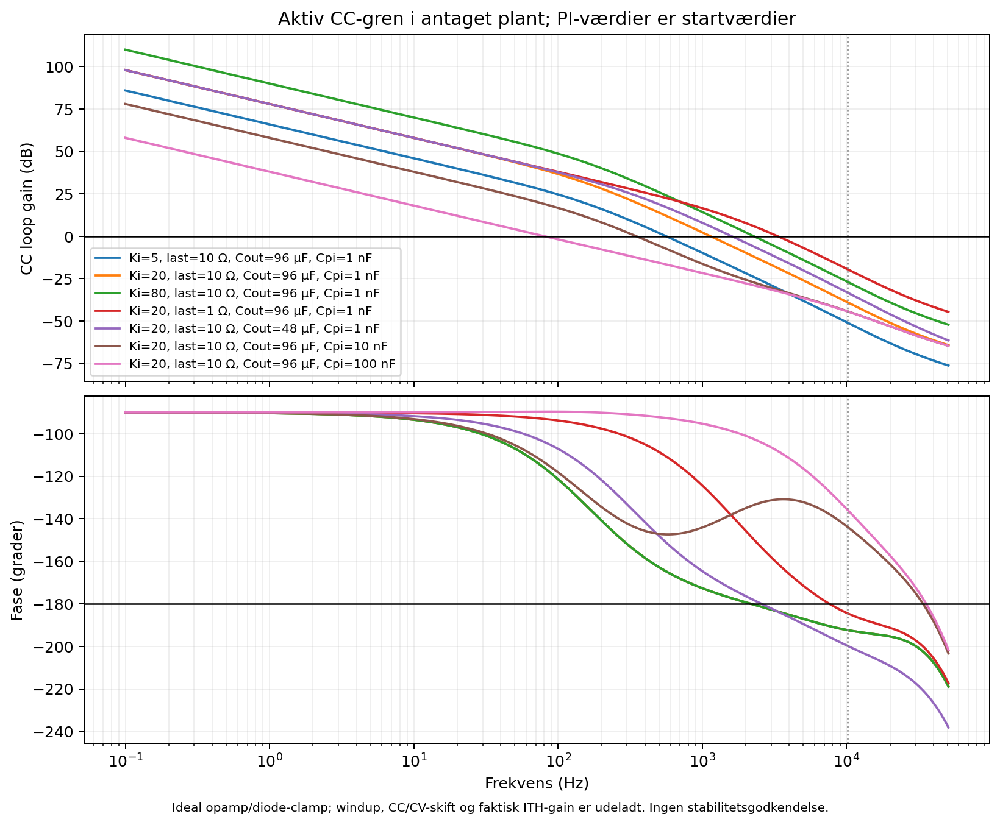
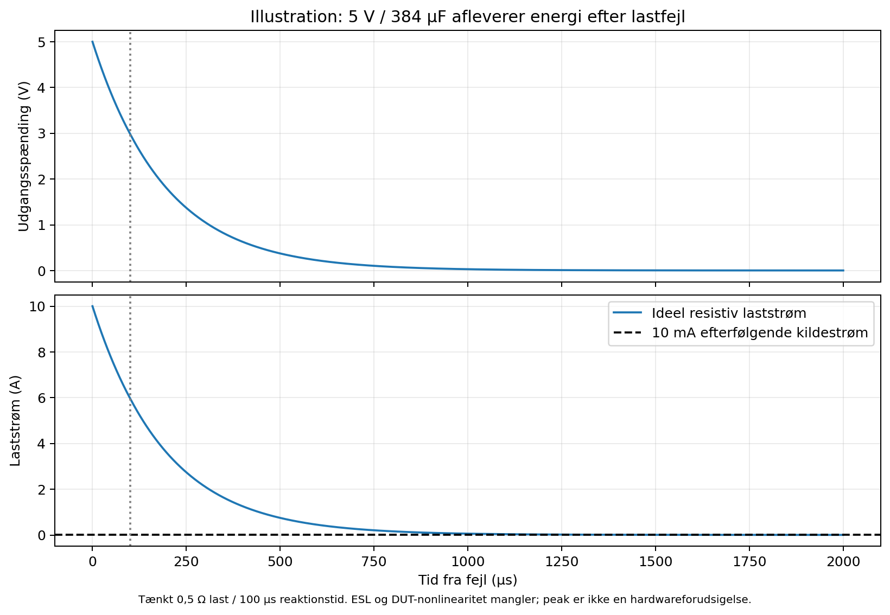

# Effekt-, ripple- og reguleringsanalyse

Analysen gør de vigtigste antagelser i enkeltfaseudkastet og den foreslåede firefasearkitektur efterprøvelige. Den indeholder **beregninger og idealiserede simulationer**, ikke en LTC3779-transistormodel, et fungerende firefasekredsløb eller hardwaremålinger. Antallet af udførte hardwaretest er **0**. De undersøgte loop-modeller frigiver hverken CC-kompensationen eller et effektprint.

Scriptet er `scripts/power_analysis.py`. Maskinlæsbare værdier og kildehashes ligger i `exports/analysis/power_analysis.json`; seks figurer findes både som PNG og selvstændige PDF'er i samme mappe. Grundbudgettet i `design_budget.json` ændres ikke af denne analyse. Ingen komponentværdi eller KiCad-fil ændres af scriptet.

## Reproduktion og afgrænsning

Kør standardscenariet fra projektmappen:

```bash
/usr/bin/python3 scripts/power_analysis.py
```

Eksempel på et separat 120 V-busscenarie, som ikke overskriver standardrapporten:

```bash
/usr/bin/python3 scripts/power_analysis.py --bus 120 --frequency 101800 --inductance-uH 150 --output-dir /tmp/psu-analysis-120V
```

Alle scriptets variable bruger SI-enheder; indgangsargumentet `--inductance-uH` konverteres eksplicit fra µH til H. Standardværdierne er 110 V bus, 101,8 kHz, 150 µH pr. fase og 10 A middelstrøm pr. fase. Fire faser er en arkitekturhypotese med ens komponenter og ideel 90° clockforskydning, ikke den eksisterende PCB's funktion.

Ren buckdrift, kontinuerlig induktorstrøm og ideelle switchforløb antages. LTC3779 har en buck-only-grænse på 91,67 % duty. Ved 100 V / 110 V er ideal duty 90,91 %, og tab/busfald kan udløse buck/boost. Modellerne omfatter ikke denne transition, uafhængig pulse skipping, faktisk valley-comparator-timing, slope compensation eller ledningsinduktans. Nuller i ideal ripple er derfor ingen hardware-ripplegaranti.

## Verificerede MOSFET-data og antagne arbejdspunkter

Datagrundlaget er Infineon **BSC110N15NS5, Rev. 2.6, 7. november 2022**, lokalt `references/BSC110N15NS5.pdf`, især s. 3–4. Skriptet registrerer SHA-256 for både dette dokument og `references/LTC3779.pdf`.

| Parameter | Fabrikantdata | Betingelse / betydning |
|---|---:|---|
| RDS(on) | 9 mΩ typisk, 11 mΩ maksimum | VGS = 10 V, ID = 38 A, Tj = 25 °C |
| Qg | 28 nC typisk, 35 nC maksimum | 75 V, 38 A, VGS = 0–10 V |
| Qgd | 5,8 nC typisk, 9 nC maksimum | Samme gatecharge-test |
| tr / tf | 3,3 / 2,9 ns typisk | 75 V, 38 A, 10 V gate og ekstern RG = 3 Ω |
| Qrr | 46 nC typisk, 92 nC maksimum | 75 V, 38 A, diF/dt = 100 A/µs |
| RθJC | 1 K/W maksimum | Junction til case; kølesystemet mangler stadig |
| Tj | 150 °C maksimum | Absolut grænse; intet ønsket kontinuerligt driftspunkt |
| RθJA | 50 K/W på fabrikantens testkort | 40 × 40 × 1,5 mm FR4, lodret, 6 cm² drainkobber på 70 µm, stille luft |

Qg og Qgd under fabrikantens test kan ikke direkte fastlægge switchinghastigheden med LTC3779. Driverimpedans, faktisk gate-modstand, Miller-spænding, parasitter og 110 V / 10 A-arbejdspunktet påvirker forløbet. Databladets 6,2 ns samlede tr + tf anvendes som et **kildetest-scenarie**; 40 og 100 ns er særskilte følsomhedsantagelser. Ingen af disse tider er målt i dette design.

RDS(on)-faktorer på 1, 1,5 og 2 sammenlignes. De er scenarier relativt til 25 °C-maksimumsværdien, ikke en digitalisering eller garanti af fabrikantens temperaturkurve. Gateeffekten bruger 35 nC som reference; body-diodens 0,88 V og 60 ns controller-deadtime er typiske testdata med andre betingelser. Der er ikke etableret et worst-case-tab via disse blandede testpunkter.

## MOSFET-tab i ren buck

Q1/Q2 er den skiftende input-halvbro, Q4 leder kontinuerligt, og Q3 antages slukket. Med trekantformet ripple gælder `IL,rms² = Iavg² + ΔIL²/12`. Beregnede ledetab er Q1: `IL,rms² × RDS × D`, Q2: `IL,rms² × RDS × (1−D)` og Q4: `IL,rms² × RDS`. Den simple hard-switch-approksimation er `Poverlap = ½ × VIN × Iavg × fs × (tr+tf)`.

Ved 110 V ind, 99,6 V ud og 10 A er ripple 0,617 A p-p. Med 11 mΩ bliver ledetabene cirka 0,996 W i Q1, 0,104 W i Q2 og 1,100 W i Q4. Hot-faktor 2 fordobler disse tab. Ved 100 ns samlet overgangstid tilføjer overlap-approksimationen **5,599 W** i Q1.

| Beregningsscenarie ved 99,6 V / 10 A | Delsum for MOSFET-/gateeffekt |
|---|---:|
| RDS-faktor 1; 6,2 ns; Qrr skaleret fra 46 nC | 3,242 W |
| RDS-faktor 1,5; 40 ns; Qrr skaleret fra 46 nC | Omtrent 6,24 W |
| RDS-faktor 2; 100 ns; Qrr skaleret fra 46 nC | 10,694 W |
| RDS-faktor 2; 100 ns; Qrr skaleret fra 92 nC | 11,209 W |

Qrr-leddet anvender `VIN × Qrr × fs`. Det er en referenceskalering, fordi Qrr er målt ved 75 V / 38 A; hverken 46 eller 92 nC er specificeret som 110 V / 10 A-værdi. Recoverysystemets energi fordeles ikke nødvendigvis som modellens konservative tildeling til Q1. Gateeffekten cirka 71 mW tilhører driverforsyningen, ikke direkte MOSFET-junction.

**Delsummen udelader Coss/Eoss, ringing, snubbertabe, bootstrap-vedligeholdelsespulser, controllerens eget forbrug, hjælpe-LDO, PCB-kobber, shunter, spole, stik og kabler.** Databladets Coss ved ét spændingspunkt er ikke nok til korrekt Eoss-integration. Tallene kan derfor ikke omsættes til dokumenteret 95 % DC-effektivitet. Begge halvbroers switching i buck/boost kan øge tab og ændre fordelingen.



## Termisk følsomhed og spolekrav

Det mest belastende viste buckscenarie tildeler cirka **8,622 W** til Q1, 0,316 W til Q2 og 2,201 W til Q4. Det kombinerer RDS-faktor 2, 100 ns overgangstid og Qrr-referenceskalering fra 92 nC. Dette er en scenariekombination, ikke et fabrikantgaranteret værstefald.

Ved 50 °C lokal omgivelse giver `Tj = Tamb + P × Rθ` følgende følsomhed:

| Antaget samlet junction-til-omgivelse | Q1, lineær temperaturindikator | Q4, lineær temperaturindikator |
|---|---:|---:|
| 5 K/W | 93,1 °C | 61,0 °C |
| 15 K/W | 179,3 °C | 83,0 °C |
| 50 K/W | 481,1 °C | 160,0 °C |

Værdier over 150 °C angiver, at scenariet **overskrider komponentgrænsen**; en transistor kan ikke fortsætte sin normale drift til den beregnede temperatur. Tabellen er ikke en fysisk temperaturforudsigelse. Der findes ingen løst, koblet junction/RDS/PCB/blæsermodel, og temperaturen på andre effektdele kan påvirke samme køleflade. Med et foreløbigt 125 °C designmål og 50 °C omgivelser kræver det viste Q1-scenarie højst cirka **8,70 K/W** i den samlede termiske vej. Dette er et dimensioneringsinput, ikke det eksisterende prints målte værdi.

Spolen er stadig **150 µH som krav uden valgt fabrikant/MPN**. Scriptet sammenligner DCR = 5/20/50 mΩ, antaget kernetab = 1/3/8 W og Rθ = 3/10 K/W. Ved 10 A er kobbertabet cirka 0,5/2/5 W før stærk temperaturændring. Den største kombination kan nærme sig 13 W og over 130 °C temperaturstigning. Kerne, antal vindinger, luftgab, materialets tabskurve og AC-viklingstab er ikke specificeret; antaget kernetab erstatter ikke Steinmetz-/fabrikantdata.

L-tolerance −20 % giver 2,251 A p-p ved 55 V ud på 110 V-bussen. Den specificerede maksimale buck-valley-threshold på 110 mV og en 1 % lav 6 mΩ-shunt giver 18,519 A valley. Ved 120 V bus og L = 120 µH bliver den idealiserede peak omtrent **20,97 A**, før ekstra transienter. Det eksisterende krav om varm Isat ≥25 A og Irms ≥15 A skal derfor verificeres med den faktisk valgte spole; 10 A middelstrøm er ikke tilstrækkeligt som mætningsrating.

## Input-/outputkondensatorernes ripple

Scriptet samler ideelle fasestrømme over en switchperiode og integrerer outputbankens AC-strøm. Inputbanken ses som én fælles bank med ideal strømdeling. Den faktiske fordeling mellem lokale keramiske kondensatorer og bulk afhænger af ESR, ESL og layout.

For én fase er udgangsbankens ideelle ripple-RMS `ΔIL/√12`, og den kapacitive spændingsripple er `ΔIL/(8 × fs × C)`. ESR bidrager med `ESR × iC(t)`; de to spændingskurver summeres før p-p bestemmes. Den anvendte inputstrøm omfatter spoleripple, så den er lidt større end den sædvanlige tilnærmelse `Iavg × √(D(1−D))`.

| Ideal scenario, fuld nominelt antaget C, 20 mΩ ESR pr. fase | Inputbank A RMS | Outputbank A RMS | Udgang mV p-p |
|---|---:|---:|---:|
| Én fase, 55 V / 10 A, 96 µF | 5,013 | 0,520 | 37,12 |
| Én fase, 99,6 V / 10 A, 96 µF | 2,931 | 0,178 | 14,64 |
| Fire ens faser, 55 V / 40 A, 384 µF / 5 mΩ | 0,520 | 0,000 | 0,00 |
| Fire ens faser, 99,6 V / 40 A, 384 µF / 5 mΩ | 4,850 | 0,122 | 2,12 |

**Nulripple ved 55 V gælder udelukkende perfekt matchende, kontinuerlige faser.** Tolerance, ujævn strøm, pulstiming, støj og parasitter bryder aflysningen. Den eksisterende bankkravsværdi omkring 5 A RMS til én fase er en størrelsesorden; beregningen 5,013 A viser behovet for reel margin og temperatur-/frekvensderating i et konkret komponentvalg.

Scriptet sammenligner 50 og 100 % effektiv kapacitet samt 20 og 100 mΩ ESR pr. fase. Disse er **scenarier**, ikke data for de endnu ukendte 47 µF/200 V-dele. Den konkrete 96 µF nominelle bank består af 94 µF bulk plus to 1 µF keramiske kondensatorer; keramikkernes DC-bias påvirker kun deres del. En samlet 50 %-reduktion er en følsomhedssituation og må ikke forklares som en verificeret X7R-biasmodel for hele banken. Kondensatorernes ripple-rating, ESR ved temperatur/frekvens, termiske vej og levetid er stadig åbne valg.



## Firefaset strømfordeling: konkrete modeksempler

Fælles ITH er ikke en dokumenteret matching-funktion. Som i `docs/multiphase-research.md` gælder i buck `Iavg ≈ Ivalley + ΔIL/2`. Denne analyse løser en fælles valley-sensekommando, så totalstrømmen er præcis 40 A, men tillader forskellige L, shunter og **hypotetiske** comparatoroffsets.

Eksemplet bruger L = 120/135/165/180 µH, shunter = 5,94/6,06/5,94/6,06 mΩ og tænkte offsets = +3/+1/−1/−3 mV. Ved 55 V ud bliver fasestrømmene **10,796 / 10,149 / 9,816 / 9,239 A**. Totalen er 40 A, men den højeste fase ligger næsten 8 % over 10 A. Dette er et modeksempel til automatisk ens strøm, ikke en forudsigelse af konkrete LTC3779-eksemplarer.

| Hypotetisk offsetgrænse, med L ±20 % og shunt ±1 % | Mindste fase i hjørnesweep | Største fase i hjørnesweep |
|---|---:|---:|
| 0 mV | 9,585 A | 10,419 A |
| ±1 mV | 9,336 A | 10,671 A |
| ±3 mV | 8,838 A | 11,173 A |
| ±5 mV | 8,341 A | 11,676 A |

Hvert række undersøger 4.096 kombinationer af fire fasers L-, shunt- og offsethjørner ved 55 V ud. Databladets **70–110 mV gælder den maksimale buck-sensetærskel under dens test**, ikke comparatoroffset eller matching ved 10 A. Intervallet er derfor ikke anvendt som offsettolerance. En dokumenteret phasestrømgrænse skal baseres på faktisk gain/offset/temperaturdata eller kvalificerende målinger, inklusive buck/boost-overgang. Selv tab af en fase kan ikke reduceres til ideal totalstrømdeling, fordi de delte ITH/PLLIN-pins kan overskride den slukkede fases V5-grænser.



## gm, RC-ækvivalens og CV-loop-følsomhed

Scriptet kontrollerer numerisk, at fire identiske 10 kΩ + 10 nF seriegrene med 100 pF shunt hver i parallel er ækvivalente med 2,5 kΩ + 40 nF og 400 pF. Fire typiske gm på 1,5 mS giver 6 mS; det idealiserede `gm × Zcomp` bliver dermed uændret. En ens skaleret firefaset current-to-voltage-plant med fire gange C, en fjerdedel lastmodstand og fire gange current-command-gain er også algebraisk ækvivalent. Det viser kun småsignalregningens skaleringsbetingelse.

CV-modellen bruger en antaget indre strøm-loop-pol ved fs/10, en delay på 0,5 switchperiode og **Ki = 5/20/80 A/V som tænkte parametre**. Ki er ikke udledt af LTC3779's maksimale threshold og er ikke verificeret fabrikantdata. Lastimpedansen modelleres med R = 10 Ω, C = 48/96 µF og ESR = 50 mΩ. Den faktiske voltage-servo i styrekortet og dens ekstra loading/poler er ikke inkluderet.

| Antaget CV-plant | Crossover | Fasemargin i netop denne model |
|---|---:|---:|
| Ki = 5 A/V, 96 µF | 1,892 kHz | 43,6° |
| Ki = 20 A/V, 96 µF | 5,481 kHz | 45,0° |
| Ki = 80 A/V, 96 µF | 14,719 kHz | 21,8° |
| Ki = 20 A/V, 48 µF | 9,031 kHz | 29,1° |
| Fire gm på én uændret RC-gren | 14,719 kHz | 21,8° |

De høje crossovers over fs/10 er særskilt markeret i JSON og figuren. Et gennemsnitsmodelresultat tæt på switchfrekvensen skal ikke tolkes som en pålidelig sampled-data-forudsigelse. Tabellen viser, at ukendt power-stage-gain og kapacitet kan ændre marginen markant; den giver ingen stabilitetsgodkendelse.



## Eksperimentel CC-gren og overgang mellem CV/CC

En anden gennemsnitsmodel analyserer den **aktive** ITH-sinkgren i styrekortet: R8 = 20 kΩ, R9 = 10 kΩ og C8 = 1 nF samt INA240A2's nominelle 50 mV/A fra en 1 mΩ-shunt. Sensoren antages at måle DUT-strøm; outputkondensatorens strømbidrag indgår gennem lastimpedansen. Diode og opamp antages ideelle, og clampen antages at kunne styre ITH. Disse sidste to antagelser skal verificeres fysisk og er ikke en dokumenteret overføring mellem CC_OUT og phasestrøm.

Ved den tænkte Ki = 20 A/V, 10 Ω og 96 µF giver de aktuelle 1 nF-startværdier crossover omkring **1,138 kHz** og kun **5,9° modelmargin**. Ki = 80 A/V giver cirka **−0,4°** i samme model. Det viser en konkret risiko ved at opfatte den foreløbige kompensation som frigivet. Plot/JSON sammenligner også 10 og 100 nF i PI-grenen ved samme tænkte plant; ingen alternativ værdi er automatisk valgt i CAD ud fra disse resultater.

| Tænkt CC-plant / PI-kondensator | Crossover | Fasemargin i modellen |
|---|---:|---:|
| Ki = 5 A/V, 10 Ω, 96 µF; 1 nF | 561 Hz | 15,2° |
| Ki = 20 A/V, 10 Ω, 96 µF; 1 nF | 1.138 Hz | 5,9° |
| Ki = 80 A/V, 10 Ω, 96 µF; 1 nF | 2.275 Hz | −0,4° |
| Ki = 20 A/V, 1 Ω, 96 µF; 1 nF | 3.328 Hz | 18,9° |
| Ki = 20 A/V, 10 Ω, 48 µF; 1 nF | 1.598 Hz | 7,0° |
| Ki = 20 A/V, 10 Ω, 96 µF; tænkt 10 nF | 348 Hz | 35,7° |
| Ki = 20 A/V, 10 Ω, 96 µF; tænkt 100 nF | 80 Hz | 90,4° |

Den langsommere 100 nF-case giver større småsignalmargin i modellen, men dens langsommere reaktion kan øge fejlenergi og opampmætning. Den kan derfor ikke vælges alene ud fra fasemarginen.

CC/CV-overgangen er ikke lineær: diodeindkobling, opampmætning, integrator-windup, native IAVG-clamp, spændingsservo, soft start og lastfrakobling påvirker hinanden. Bodekurver for en aktiv gren kan ikke dokumentere denne overgang. Den konkrete konstruktion kræver mættet/nonlineær simulation med en identificeret controller-model samt fysiske lastspring og loopmålinger i begge tilstande, gennem bus-/temperatur-/lastområderne. Anti-windup eller anden dokumenteret mætningstilbagekobling er fortsat ikke færdigdesignet.



## Fejlenergi, tilbageført energi og beskyttelsesgrænser

En ideal resistiv fejlmodel viser, hvorfor lav buck-strømindstilling alene ikke beskytter et lille prøveprint mod udgangskondensatorens energi. Med 5 V på 384 µF, en tænkt 0,5 Ω fejl og 100 µs reaktionstid er den lagrede energi **4,8 mJ**. Den idealiserede startstrøm er **10 A**, selv når regulatorens efterfølgende kildestrøm sættes til 10 mA. Modellen ignorerer lednings-ESL og DUT-nonlinearitet; den forudsiger ikke den faktiske peakstrøm. Pointen følger af den eksisterende energi efter strømbegrænseren og gælder også ved øjeblikkeligt RUN-stop.

Ved 100 V indeholder fire nominelle 96 µF-banker **1,92 J**. Der kræves en konkret energi-/afbryder-/udladningsarkitektur efter banken for at opfylde ønsket om følsomme små print. En fremtidig outputafbryder skal vurderes med faktisk MOSFET-SOA og fejlstrøm; en VDS-rating alene dokumenterer ikke linear-mode eller kortslutning.



Et separat energiregnestykke antager 384 µF på 110 V-bussen og ingen energisink: **1 J tilbageført energi hæver bussen til 131,56 V**. Kun cirka **0,442 J** er nok til at hæve den antagne bank fra 110 til 120 V. AC/DC-modulerne antages ikke at kunne absorbere energien. Den faktiske buskapacitet, clamps, frakobling og timing mangler, og Mean Well-modulernes statiske OVP er ikke en transientclamp.

| Hændelse | Hvad beregningen afklarer | Uløst eller krævet validering |
|---|---|---|
| Lastkortslutning efter bulk | CC kan ikke tilbagekalde allerede lagret energi | Udgangsbegrænser/afbryder, reel impuls, SOA og discharge |
| Én fase slukker på fælles ITH | Totalstrøm alene dokumenterer hverken pin-grænser eller remaining-phase-strøm | Sikker delt-signalarkitektur og fejlstop af alle faser |
| Busfald ved 100 V ud | Driftspunktet ligger tæt på buck/boost-overgangen | Gateforløb, tab, ripple, loop og balance i transition |
| Tilbageført energi / negativ fasestrøm | Få joule kan give bus-OVP uden sink | Målt energi-vej, clamp/frakobling; system må ikke antages at være en strømsink |
| Manglende sense-/kommandoledning | En generisk current-loop-model kan skjule fejlen | Konkrete guard-net, åben-ledningstest og fejllåsning |
| Blæser-/kølingsfejl | Termisk margin kan forsvinde før elektrisk strømgrænse | Temperaturfølere, placering, OTP og varm kontinuerlig drift |

## Hvad de gennemførte kontroller viser

Scriptet indeholder syv grupper af meningsfulde numeriske checks: buck-endepunkter og L-skalering, trekant-RMS og integreret ripple-identitet, perfekt firefaseaflysning ved D = 0,5, præcis totalstrøm i faseeksempler/sweeps, parallel RC-/gm-ækvivalens, ens skaleret outputplant og fejlmodellens start-/dischargegrænse. De checks er bestået for standardscenariet; et særskilt 120 V-scenarie kan reproduceres med kommandoen ovenfor.

Der er ingen faktisk SPICE-model af LTC3779 eller strømclampen i leverancen. Der er ingen fysisk thermal-, ripple-, CV/CC-, fejl-, isolation- eller 4 kW-test. De modellerede forskelle peger på de nødvendige designinput: konkret spole/bulk/køling, identificeret current-command-transfer, sikker fasefejlarkitektur, kompenserede aktive CC/CV-sløjfer og beskyttelse efter udgangens energilager.

## Primære kilder

1. Infineon, BSC110N15NS5 Rev. 2.6: https://www.infineon.com/assets/row/public/documents/24/49/infineon-bsc110n15ns5-datasheet-en.pdf — s. 3–4 modstand, thermal, timing og ladningsdata. Lokale filer og kildehash: `references/BSC110N15NS5.pdf` og `references/BSC110N15NS5.source.json`.
2. Analog Devices, LTC3779 Rev A: https://www.analog.com/media/en/technical-documentation/data-sheets/ltc3779.pdf — s. 2 pin-grænser, s. 3 gm/threshold, s. 4 gate-delay, s. 14–18 drift, s. 31–32 loop-vurdering. Lokal fil: `references/LTC3779.pdf`.
3. Projektets aktuelle enkeltfaseværdier: `bom/power-phase.csv` og `docs/power-phase.md`; eksperimentel CC-gren: `scripts/control_gen.py`. Et lokalt reference-/CAD-valg er ikke selv fabrikantvalidering.
