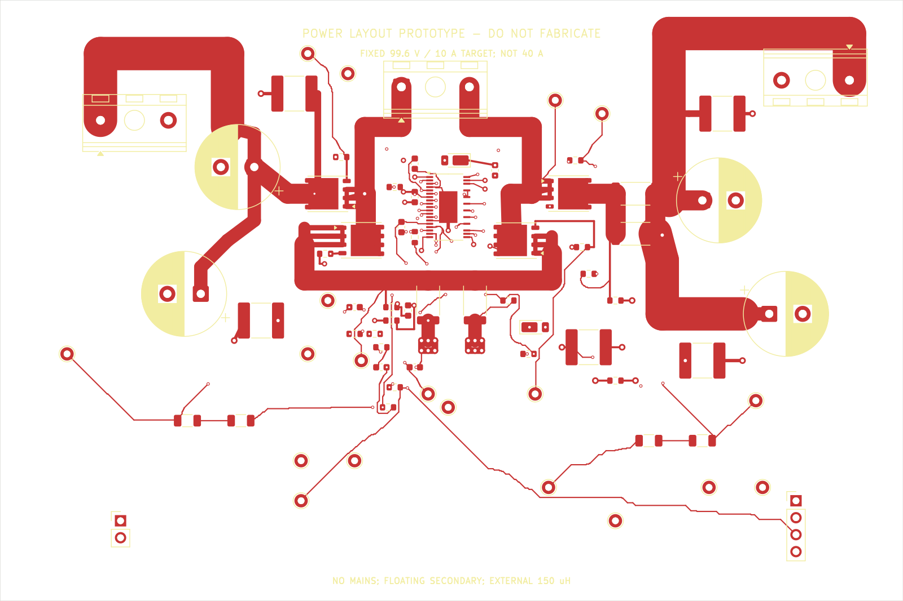
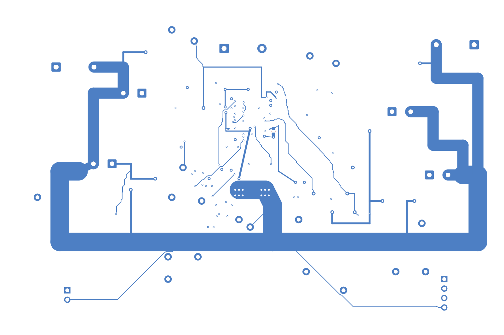

# Effektfase: fysisk layout og CAD-kontrol

Effekt-PCB'et er et **komplet CAD-routet konstruktionsudkast til én LTC3779-fase med 99,6 V fast setpunkt og 10 A som udviklingsmål**. Det implementerer ikke den samlede 0–100 V / 40 A laboratorieforsyning. Alle tilsigtede CAD-nets er forbundet. Kortets switching, strømkapacitet, varme, stabilitet og fault-respons er endnu ikke verificeret fysisk; det må ikke bruges som et færdigt effekttrin.

Den aktuelle kontrol giver **0 ERC-fund, 0 geometriske DRC-fund, 0 manglende forbindelser og 0 schematic-parity-fund**. Samlet DRC giver **exitkode 0 / PASS**. Der findes 1551 banesegmenter og 111 vias, i alt 1662 sporobjekter, mod tidligere 0 sporobjekter. Der er ingen fabrikationsfrigivelse eller fysisk strøm-/varme-/looptest.

## Filer og reproduktion

| Indhold | Fil |
|---|---|
| Native projekt, diagram og PCB | `design/power/power_phase.kicad_pro`, `.kicad_sch`, `.kicad_pcb` |
| Spændings- og geometri-regler | `design/power/power_phase.kicad_dru` |
| Generator med placeringer og automatisk routing-replay | `scripts/power_phase_gen.py` |
| Deterministisk slutgeometri og replay | `scripts/power_routing_plan.json`, `power_signal_route.py` |
| Firelags søge-router til udvikling | `scripts/power_route_grid.cpp` |
| Strøm-, kobber- og tabseksempler; negativ regeltest | `scripts/power_layout_budget.py` |
| Komponenter, værdier og status | `bom/power-phase.csv` |
| Fysisk reference/position/rotation | `exports/power/placement.csv` |
| Faktiske kontrolresultater | `exports/power/layout_summary.json`, `erc.json`, `drc.json` |
| Hver manglende forbindelse med koordinater | `exports/power/remaining_connections.json` |
| Manglende forbindelser fordelt på net | `exports/power/remaining_nets.json` |
| Beregningsforudsætninger og resultater | `exports/power/layout_budget.json` |
| Dokumenteret aktiv HV-regelkontrol | `exports/power/hv_rule_negative_check.json` |
| Isoleret regeneration, kommandoer og geometriske SHA256 | `exports/power/reproduction_check.json` |
| Kobberlag og montageoversigt til review | `exports/power/pcb_layers.pdf`, `pcb_assembly.pdf`, `pcb_assembly_back.pdf` |

Fra repository-roden kan kilder og rapporter dannes med:

```bash
bin/kicad-env /usr/bin/python3 scripts/power_phase_gen.py
bin/kicad-env /usr/bin/python3 scripts/power_layout_budget.py
```

`power_phase_gen.py` gendanner placeringerne og de oprindelige håndførte effektveje og kalder derefter automatisk `power_signal_route.py --replay`. Replay erstatter kobberet med den gemte slutgeometri, efter at hvert fysisk pad/net-par er kontrolleret. Filer og eksporter dannes først derefter. C14 er den eneste komponent på B.Cu. Native severity-map, netklasser og regler bevares ved replay. En fuld regeneration er efterprøvet i en isoleret kopi.

Søge-routeren uden `--replay` er et udviklingsværktøj, der tilføjer ruter mellem native DRC-airwires. Den udfører ikke elektrisk loop- eller termisk optimering. Den er ikke nødvendig for normal reproduktion. Gemning af en ny plan med `--capture` kræver en ny komplet DRC- og fysisk layoutgennemgang.

Generatoren bruger `--severity-all`, `--schematic-parity` og `--exit-code-violations` ved DRC. Manglende forbindelser eller clearance-fund er ikke skjult gennem severity-regler eller DRC-exclusions. Generatoren afslutter med exitkode 5, hvis ERC/DRC finder fejl; exitkode 0 dokumenterer CAD-kontrollen og kvalificerer ikke kortets elektriske eller termiske drift. Filen `drc_unrouted.json` beholdes som kompatibilitetsnavn og indeholder samme aktuelle rapport som `drc.json`.

## Placering og strømveje

Kortet er 135 × 90 mm. Indgang og udgang ligger mod hver sin kant, de fire MOSFET'er ligger øverst omkring controlleren, og shunter og analoge filtre ligger nedenunder. Fysiske koordinater og rotationer findes i `placement.csv`; alle værdier og footprints findes i BOM'en.

| Gruppe | Placering og formål |
|---|---|
| J1, C1/C2, C5/C6 | VIN og det lokale inputlager; ingen 230 V AC eller PE på dette kort |
| Q1/Q2, SWA | Input-halvbro; gate TG1/GA og BG1/GB er routet til egne MOSFET'er |
| L1-terminal | Tilslutning til ekstern 150 µH-spole; selve spolen og terminalens endelige MPN er uafklaret |
| Q3/Q4, SWB | Output-halvbro; BG2/GC og TG2/GD er alle forbundet |
| R1/R2 | Parallelle 12 mΩ-shunter, samlet 6 mΩ; cyklus-Kelvin-tap ved shuntens egne CS/PGND-pads |
| R3/R4 | Parallelle 8 mΩ-shunter, samlet 4 mΩ; output-average-filtergrene er routet fra disse pads |
| C3/C4, C7/C8, J2 | Udgangslager og udgangsterminal |
| U1, C9, D1/D2, C13/C14 | Controller, DRVCC-afkobling og to bootstrap-kredsløb med hver sin switching-reference; C14 ligger på B.Cu ved (73,25; 35,30) mm |

Frontvisningen viser F.Cu, silketryk og printkant. Bagvisningen viser B.Cu, silketryk og printkant. Innerlag skal ses i KiCad og i den separate lagrapport. CAD-kontrollen finder ingen resterende airwires; billederne dokumenterer geometrien og er ikke en fysisk kvalifikation.





VIN, PREOUT og VOUT bruger brede yderlagsbaner. SWA og SWB holdes som afgrænsede strømveje; der er ikke tilføjet et stort kobberplan under disse switching-net. Deres kobberareal, routing, eksterne spoleledninger og returnet skal fortsat vurderes for parasitisk induktans og EMI.

Hver MOSFET har tre separate korte 0,8 mm kilde-pad-grene frem til et lokalt samlepunkt. De giver samlet 2,4 mm nominelt gren-kobber, forudsat nogenlunde ligelig strømfordeling. Pad-/loddeforbindelsernes varme og faktisk strømfordeling er endnu ikke verificeret. Hovedstrømsbanerne er 5 mm; lokale switching-/shunt-forbindelser er 3 mm. Korte 1–2 mm indløb til gennemgående kondensatorpads fremgår eksplicit af generatoren.

PGND-hovedreturen ligger på B.Cu og tilsluttes input-/outputkondensatorernes retur og shunternes PGND-pads. R1/R2 har hver seks gennemgående 1,0/0,5 mm vias ved power-returen. Via-antal er en foreløbig konstruktionsbeslutning, ikke en verificeret strømklassifikation. Signal-ground og driver-afkobling går separat til shuntens PGND-område. Den negative cyklus-Kelvin-gren går på In2.Cu direkte til R1's PGND-pad. Den positive gren kommer fra R1's CS-pad. Det er målegrene; de skal ikke føre belastningsstrøm.

SENSEP/SENSEN er routet gennem R15/R16 og C15 til controllerens pins 11/12. Average-current-grenene gennem R17/R18 og C16 er forbundet til controllerens IAVGP/IAVGN og testpunkter. Alle fire gates kan gennemgås sammen med deres source-reference. C14 er flyttet til bagsiden for at give separate højvolt-fanouts ved U1 uden at overlappe Q3 på fronten. Bootstrap-/SWB-reference går via egne gennemgående vias; SWB-reference-via er ved (73,25; 36,85) mm og holder den gældende 1,5 mm afstand til BG2 på In1.Cu. De fine U1-escapes er korte 0,18 mm signalgrene, ikke strømveje til lasten. Gateværdierne 0 Ω er udviklingsstartværdier, som kræver måling af ringing og retuning.

TG1 har **ingen testpunktgren**. Vejen fra U1 pin 37 til R11 pad 1 er kortet fra **43,46 til 28,38 mm** native banesum, ca. **35 %**, ved at fjerne omvejen ved y=16 mm. Det korte F.Cu-escape og de eksisterende vias er bevaret. Den nye **0,30 mm In2.Cu-bane** går fra (72,50; 27,00) via (72,30; 25,60), (70,00; 23,80), (67,30; 22,00), (61,00; 20,10), (58,20; 20,10) og (57,00; 20,20) til R11 ved (50,175; 23,50). Den omgår eksisterende gennemgående HV-/lavvolt-vias med de gældende afstande. Der er ingen komponentflytning eller regellempelse, og alle ikke-TG1-kobberobjekter er uændrede.

Fra R11 pad 2 til Q1 gate er den funktionelle GA-gren **3,595 mm**. Samlet giver det ca. **32,0 mm routet kobber** fra driver til gate, eksklusive forbindelsen inde i R11. Summen er en native centerlinjemåling; efter U1-padrettelsen ligger det første gamle banepunkt 0,0875 mm fra det nye padcenter, så en padcenter-til-padcenter-opmåling er ca. **32,07 mm**.

GA-nettets samlede **21,87 mm** indeholder ca. **18,28 mm til TP16**, som ikke er i serie med driver-gate-strømmen. Testpunktgrenen bidrager stadig med parasitter og skal med i fysisk review. CAD-PASS beviser ikke gate/source-sløjfens induktans, driver-ringing eller passende gate-modstand. Den foretagne kortning er kontrolleret med fuld DRC og isoleret replay; samlet gate/source-/bootstrap-review og fysisk måling kræves fortsat. Der er ikke dokumentation for, at alle yderligere forbedringer nødvendigvis kræver større komponentflytning.

## Kobber og netklasser

Native PCB-stackup indeholder fire kobberlag med **70/35/35/70 µm** kobber og en foreløbig nominel totaltykkelse på 1,60 mm. Maskelag og dielektriske tykkelser er et konstruktionsønske; FR4-fabrikat, CTI, laminatdata, endelig lagopbygning og minimum færdig kobber-/via-belægning er ikke valgt eller aftalt med en printproducent. In1.Cu/In2.Cu bruges her til styresignaler, ikke som færdigt power-/groundplan.

| Netklasse | Net / funktion | Nominel banebredde | Klasse-clearance |
|---|---|---:|---:|
| Power | VIN, VOUT, PREOUT, SWA, SWB | 5,0 mm | 1,5 mm |
| PowerReturn | CS, PGND; høj strøm, lav indbyrdes spænding | 5,0 mm | 0,25 mm |
| HV | Flydende højside-gates/bootstrap, output-sense, høje dividertrin | 0,5 mm | 1,5 mm |
| Default | Lavvolt-styresignaler | 0,3 mm | 0,25 mm |

Banebredder i netklasser er router-standarder. De er ikke en påstand om, at hver pad-indgang eller hver power-forbindelse er 5 mm bred. Den faktiske rute og korte neck-downs er synlige i native PCB og kobber-PDF'en. Mindste styresignalbane er 0,18 mm, mindste almindelige via 0,5/0,3 mm, og kobber holdes mindst 1,0 mm fra printkanten.

Strømbredden er sammenlignet med den klassiske empiriske yderlagsfit `I = 0,048 × ΔT^0,44 × A^0,725`, hvor A er kobbertværsnit i kvadratmils. Den er ofte omtalt som IPC-2221-fit og er et groft dimensioneringsværktøj. Den er ikke en IPC-2152-vurdering af dette konkrete kort, dets køling eller nabobaner.

| Strøm ved antaget 20 K temperaturstigning | Beregnet bredde, 35 µm yderkobber | Beregnet bredde, 70 µm yderkobber |
|---:|---:|---:|
| 10 A | 4,72 mm | 2,36 mm |
| 13,26 A | 6,97 mm | 3,49 mm |
| 20,5 A | 12,71 mm | 6,36 mm |
| 40 A | 31,97 mm | 15,98 mm |

De 5 mm hovedbaner ved 70 µm giver ca. 17,22 A i samme grove 20 K-fit. Det er en beregning, ikke et 17 A produktløfte. 20,5 A er et worst-case cyklus-peak, ikke den forventede kontinuerlige strøm. Kortet må ikke krediteres som et 40 A-effektlayout. Et 50 mm langt 5 mm/70 µm kobberstykke har ca. 2,46 mΩ ved 20 °C og ca. 0,246 W tab ved 10 A; modstanden stiger med temperatur. Terminaler, vias, pad-indløb og kobbervariation er ikke med i dette simple tal.

## Spændingsregler og package-undtagelser

Reglerne i `.kicad_dru` bruger eksplicit `mm`. De er funktionelle regler for den flydende sekundærside med højst 120 V DC i udviklingsopstillingen. De fastlægger ikke netisolation, berøringssikkerhed, krybestrækningsklasse eller certificering. Den valgte frontend skal have selvstændig bus-overspændingsbeskyttelse; dens potentielle statiske overvoltage-threshold kan overstige effektfasens 120 V-grænse.

Den generelle HV-/power-clearance er 1,5 mm. Fysisk små halvlederpackages kan ikke give denne afstand mellem alle tilsigtede naboterminaler:

* LTC3779 FE38(31) har 0,5 mm pitch og ca. 0,3 mm padbredde i pitch-retningen. Det giver 0,2 mm mellem tilstødende pads. På højvolt-siden er flere benpositioner fysisk fjernet; de resterende højvolt-ben har større indbyrdes afstand. Den mindste native højvolt-padafstand til EP/PGND er ca. 0,880 mm, og højvolt-pads på 1,0 mm pitch har ca. 0,7 mm mellemrum.
* U1 har derfor en **0,7 mm package-lokal regel** og **0,2 mm lokale regler for navngivne nabopar med lav indbyrdes spænding**. Almindelige U1-lavvoltsignaler er højst ca. 12 V relativt til PGND. SWA/TG1/BST1 og SWB/TG2/BST2 kan have høj common-mode-spænding, men deres indbyrdes forskel er gate-/bootstrap-spænding omkring 10 V. Den lave 0,2 mm-regel bruges ikke som generel tilladelse mellem 100–120 V og PGND.
* BSC110N15NS5-footprintets source/gate-pitch er 1,27 mm og padbredden i pitch-retningen ca. 0,65 mm, hvilket giver ca. 0,62 mm mellem tilstødende pads. Den native drain-/source-padkantafstand er ca. 1,025 mm. Q1–Q4 har derfor en afgrænset 0,5 mm regel ved deres package. Pinout og footprint-type er kontrolleret mod Infineons datablad; dette erstatter ikke en produktions-/forurenings-/transientvurdering.
* 1206-dividertrin beholder 1,5 mm minimum ved deres terminaler. Små dele med lav differentialspænding ved høj common-mode har specificerede lokale 0,5 mm-regler. Flydende gate/source-par har 0,5 mm uden for den fine U1-package-geometri.

Package-reglerne bruger navngivne nets og courtyard-intersection. KiCad evaluerer objekter, ikke en fysisk isolationsgodkendelse; en banegenstand kan strække sig ud af et courtyard. Ved en efterfølgende layoutændring skal også den nærmeste konkrete pad-/banekantafstand uden for komponenten gennemgås. Undtagelsernes udstrækning må ikke bruges som en generel reduceret afstand for lange HV-baner.

En negativ kontrol på en isoleret kopi satte HV-clearance til 5 mm og fandt clearance-fund med exitkode 5. Kontrollen fandt **499 clearance-fund**; originalernes uændrede SHA256 findes i `hv_rule_negative_check.json`. Kontrollen dokumenterer, at native regler og clearance-provider faktisk kører; den er ikke en fysisk spændings- eller isolationsprøve.

## Termisk budget og åbne effektdele

Ved 10 A giver to ledende MOSFET-strømveje med 11 mΩ hver ca. **2,2 W** ved databladets 25 °C/10 V-gate-betingelser. 6 mΩ-cyklusshunten giver ca. **0,6 W** samlet, og 4 mΩ-outputshunten ca. **0,4 W** samlet. RDS(on) stiger med temperatur; dette er ikke et komplet varmt tabsbudget.

Et regneeksempel med 110 V, 10 A, 101,8 kHz og antaget samlet switching-overlap på 40 ns giver ca. **2,24 W pr. hårdt switchende strømvej**. De 40 ns er en antagelse, ikke en måling eller en garanteret fabrikantværdi ved disse forhold. Gate-charge-eksemplet med fire gates, 10 V, 101,8 kHz og fabrikantens typiske 28 nC giver ca. 0,114 W; 35 nC giver ca. 0,143 W. Reverse-recovery, Coss, spole-/ESR-tab, driver/LDO-varme og transienter skal lægges til en fysisk vurdering.

Infineon angiver RthJC højst 1 K/W. RthJA-eksemplet 50 K/W gælder en 40 × 40 × 1,5 mm FR4-testplade med **6 cm² drain-kobber i ét 70 µm lag**, lodret i stillestående luft. Dette layout etablerer ikke disse testbetingelser. Der mangler en færdig løsning for drain-kobber, termiske vias, heatsink/luftstrøm og realistisk worst-case junction-temperatur. Controllerens EP-køling skal også vurderes.

Spolen har fortsat kun krav: 150 µH, Irms mindst 15 A og varm Isat mindst 25 A. Der er ikke valgt et verificeret MPN, kerne, DCR, tabskurve eller fysisk montering. De fire 47 µF/200 V bulk-kondensatorer, shunter og effektterminaler har heller ikke alle endelige producentvalg. Bootstrap-diodens producent-footprint er uafklaret. Deres generiske footprints er derfor ikke fabrikationsgodkendte.

## Rester før et funktionelt prototypekort

`remaining_connections.json` er nu en tom liste, og `remaining_nets.json` er et tomt objekt. Der er ingen utilsigtede åbne CAD-forbindelser, ingen skjulte DRC-exclusions og ingen nedgraderede fejl. Den native CAD-PASS omfatter også gennemgående via-kobber på alle fire lag. Det samlede laboratorieprodukt, termisk løsning og de uafklarede effektkomponenter er fortsat reelle udviklingsopgaver.

Efter endeligt komponent-/footprintvalg kræves en uafhængig gennemgang af gate/source-sløjfer, Kelvin-reference, strømretur, fault-saturation, højvolt-clearance og termisk løsning. Derefter skal loop, ringing, SOA, kortslutningsrespons, temperatur og overspænding måles under kontrollerede forsøg. Flerfasekobling, samlet 40 A, præcis lavstrømsbegrænsning og aktiv 0 V ligger fortsat uden for denne enkeltfases verificerede implementering.

U1-landpattern er korrigeret efter LTC3779 Rev. A s. 36: lead-pads er **1,05 × 0,300 mm**, centre ved **±2,775 mm**, ydermål **6,60 mm**, pitch **0,50 mm** og EP **2,74 × 4,75 mm**. Fabrikantens angivne padbredde er 0,315 ± 0,05 mm; den valgte 0,300 mm ligger i intervallet og bevarer 0,200 mm mellem tilstødende pads. Længden 1,05 mm erstatter den tidligere generiske KiCad-længde 1,475 mm. Pinout og fjernede positioner er uændret; den større arvede courtyard bevares som konservativ montageplads. Paste-maskens EP-vinduer, loddeprofil og assembly-processen kræver stadig review.

Kilder: LTC3779 Rev. A, særlig pinfunktioner og PCB Layout Checklist, s. 11–12 og 31–32; DC2456A-4-referenceskematik; Infineon BSC110N15NS5 Rev. 2.6, s. 1, 3–4 og package-outline s. 9. Lokale PDF'er, officielle URL'er og SHA256 findes i `references/` og projektets kildeliste.
